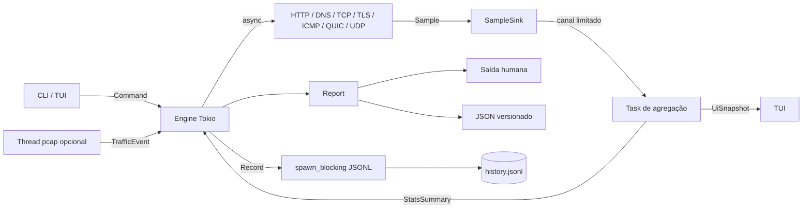

# Plano de Implementação — `netscope`

> Teste de internet em Rust com diagnóstico profundo, análise de tráfego, múltiplos protocolos, monitoramento e benchmarks.

**Objetivo:** construir uma ferramenta CLI/TUI que mede vazão útil, vazão de aplicação, tráfego de transporte, latência, jitter, perda, DNS, TCP, TLS, TTFB, bufferbloat e características do tráfego, com resultados reproduzíveis, relatórios parciais, tipagem forte e testes abrangentes.

**Arquitetura:** workspace Rust com núcleo de domínio independente de I/O, adaptadores de protocolo e binário CLI/TUI. O runtime Tokio cuida de I/O, timers e orquestração; a agregação roda em task assíncrona; `spawn_blocking` cobre trabalho bloqueante pontual; uma thread dedicada existe apenas para pcap. A comunicação é feita por canais limitados e snapshots imutáveis.

**Stack principal:** Rust 1.85+ (Edition 2024), Tokio, Hyper, rustls, hickory-resolver, quinn, surge-ping, serde/toml, clap, ratatui, rand_chacha, uuid, time, async-trait, tracing, proptest e criterion. As dependências diretas e as features opcionais estão na seção 2.5; o alvo principal de uso é Windows 10/11 para usuário comum/técnico doméstico, com Linux e macOS suportados.

---

## 1. Escopo

### 1.1 O que o produto faz

- Executa um teste pontual completo (`run`): download, upload, latência idle e sob carga, DNS, TCP, TLS, TTFB, jitter, perda, bufferbloat e qualidade da medição.
- Separa vazão útil (`payload`), vazão de aplicação, tráfego de transporte e tráfego no fio quando o pcap está disponível.
- Executa diagnóstico sem saturar o link (`diagnose`): resolução DNS, conexão TCP, handshake TLS, certificado, TTFB, ICMP, UDP opcional (com `--udp-target`) e, opcionalmente, traceroute.
- Monitora o link ao longo do tempo (`monitor`): probes periódicos leves, histórico em JSONL e thresholds.
- Compara protocolos e quantidades de streams (`bench`): execuções intercaladas com mediana, p95, mínimo, máximo e eficiência de escala. Comparação entre servidores fica para depois do v1.
- Exporta resultado humano, JSON versionado e JSONL para monitoramento, inclusive quando o resultado é parcial.
- Oferece TUI opcional em tempo real, com feature `tui`.
- Tem como alvo principal de uso Windows 10/11 (Windows Terminal) por usuário comum/técnico doméstico; Linux e macOS são suportados. Recursos que exigem privilégio ou Npcap degradam sem bloquear o teste padrão.

### 1.2 Não-objetivos do v1

- Não é um sniffer genérico de rede. A captura pcap é opcional, restrita ao fluxo de teste e sem payload.
- Não mede sinal de Wi-Fi, interferência de RF ou qualidade de operadora.
- Não raspa servidores Ookla nem contorna termos de uso de terceiros.
- Não inclui servidor público próprio no v1; os testes usam servidores locais embutidos.
- Não inclui GUI web, dashboard central, Prometheus ou alertas por e-mail/webhook.
- Não usa machine learning para "diagnóstico automático"; os graus são heurísticas documentadas.
- Não controla o algoritmo de congestionamento do SO/QUIC; usa o padrão e, quando possível, registra a configuração.
- Não altera a quantidade de streams durante uma medição; comparações usam execuções separadas.
- Não emite veredito definitivo de gargalo do servidor; reporta sinais e um nível de confiança.
- Não exige Administrador nem Npcap no caminho padrão; pcap e traceroute são capacidades opcionais e ICMP degrada para TCP se for negado.
- Não é uma ferramenta corporativa gerenciada: proxy/PAC/NTLM/Kerberos, MSI/GPO e suporte oficial a TI ficam fora do v1.

### 1.3 MVP e versão completa

| Entrega | Conteúdo |
|---|---|
| **MVP (M0–M2)** | Config TOML, HTTP/1.1 download/upload, DNS/TCP/TLS/TTFB, ICMP com fallback, jitter/perda opcionais, modo duração/bytes, bufferbloat com critérios de validade, taxas separadas, variabilidade, análise de tráfego de aplicação, qualidade/limitações do servidor, relatório parcial, CLI humana/JSON |
| **Completo (M3–M6)** | HTTP/2, QUIC/HTTP3, UDP, traceroute, pcap, TUI, monitor, bench com streams, hardening e release |

---

## 2. Arquitetura

### 2.1 Workspace

```text
netscope/
├── Cargo.toml                    # workspace, lints, perfis
├── rust-toolchain.toml           # 1.85+, Edition 2024
├── rustfmt.toml
├── deny.toml
├── README.md
├── LICENSE-MIT
├── LICENSE-APACHE
├── docs/
│   ├── arquitetura.md
│   ├── metodologia.md
│   ├── configuracao.md
│   └── testes.md
├── crates/
│   ├── netscope-core/            # domínio, config, estatística, engine
│   │   ├── src/
│   │   │   ├── lib.rs
│   │   │   ├── units.rs
│   │   │   ├── error.rs
│   │   │   ├── config/{mod.rs,raw.rs,validated.rs}
│   │   │   ├── plan.rs
│   │   │   ├── phase.rs
│   │   │   ├── sample.rs
│   │   │   ├── stats.rs
│   │   │   ├── report.rs
│   │   │   ├── quality.rs
│   │   │   ├── engine.rs
│   │   │   ├── traits.rs
│   │   │   └── aggregator.rs
│   │   ├── tests/
│   │   └── benches/
│   ├── netscope-net/             # adaptadores de protocolo e tráfego
│   │   ├── src/
│   │   │   ├── lib.rs
│   │   │   ├── http/{mod.rs,download.rs,upload.rs,timing.rs}
│   │   │   ├── dns.rs
│   │   │   ├── tcp.rs
│   │   │   ├── tls.rs
│   │   │   ├── icmp.rs
│   │   │   ├── quic.rs
│   │   │   ├── udp.rs
│   │   │   ├── traceroute.rs
│   │   │   ├── server.rs
│   │   │   └── traffic/{mod.rs,app.rs,pcap.rs}
│   │   └── tests/
│   ├── netscope-cli/             # binário `netscope`
│   │   ├── src/
│   │   │   ├── main.rs
│   │   │   ├── cli.rs
│   │   │   ├── commands/{run,diagnose,monitor,bench,config,completion}.rs
│   │   │   ├── output/{human.rs,json.rs,table.rs}
│   │   │   ├── tui/{mod.rs,app.rs,ui.rs,events.rs}
│   │   │   ├── store.rs
│   │   │   └── logging.rs
│   │   └── tests/
│   └── netscope-testkit/         # servidores locais, clock falso, estratégias
│       └── src/lib.rs
└── .github/workflows/ci.yml
```

**Por que workspace:** separa domínio puro, protocolos e interface; permite testar o núcleo sem rede e compilar a CLI sem features pesadas. `netscope-testkit` é `publish = false` e existe para evitar duplicação de servidores mock entre testes de integração e benchmarks.

### 2.2 Modelo de execução: Tokio + `spawn_blocking`

| Contexto | Responsabilidade | Justificativa |
|---|---|---|
| Runtime Tokio | I/O de rede, timers, probes assíncronos, orquestração, cancelamento | Operações concorrentes de rede e timeout |
| Task de agregação | Amostras brutas para IC, percentis, médias móveis, snapshots para a UI | 10 Hz com poucos streams é carga trivial; não justifica thread permanente |
| `spawn_blocking` | Cálculo final pesado (bootstrap/percentis com muitas amostras), append e flush de JSONL | Bloqueio pontual sem ocupar worker assíncrono |
| Thread `netscope-capture` | Captura pcap bloqueante e decodificação de metadados | API de captura é bloqueante e de longa duração; existe só com a feature `pcap` |
| Thread principal | `block_on` da CLI ou loop assíncrono da TUI | Dono do terminal e do ciclo de vida do processo |

**Regras de concorrência:**

- Nenhum `Arc<Mutex<_>>` no caminho quente. Estado compartilhado é imutável ou trocado por mensagem.
- Canais `tokio::sync` limitados dentro do runtime; a thread de captura pcap usa `blocking_send`/`try_send` no mesmo canal, sem `crossbeam-channel`.
- Amostras usam `try_send`; se o canal estiver cheio, a amostra é descartada e `dropped_samples` é incrementado. Medição nunca bloqueia por causa da UI.
- Totais de throughput vêm de contadores atômicos ou do `ThroughputOutcome` de cada probe, não da soma de amostras do canal. Descarte afeta a série da UI, não o resultado final.
- A UI recebe apenas o último snapshot (`watch`/canal de capacidade 1), não o histórico completo.
- `CancellationToken` é compartilhado por todas as fases; `Ctrl-C` cancela probes, fecha conexões e faz flush do histórico.
- Threads são nomeadas e têm `JoinHandle` monitorado; panic em worker vira erro interno, não trava o processo.
- Não criar thread permanente de estatística nem de persistência. Se profiling mostrar disputa de CPU ou deadline perdido, mover a agregação para thread atrás da mesma interface.
- Upload é streaming e com buffer limitado; não ajustar `SO_SNDBUF`/`SO_RCVBUF` por padrão. O controle de congestionamento é do SO/QUIC e apenas registrado quando disponível.

### 2.3 Fluxo de dados



### 2.4 Interfaces centrais

```rust
// netscope-core
pub trait Clock: Send + Sync + 'static {
    /// Timestamp monotônico compatível com `tokio::time`.
    fn now(&self) -> tokio::time::Instant;
}

#[async_trait::async_trait]
pub trait ThroughputProbe: Send + Sync {
    async fn download(
        &self,
        ctx: &ProbeContext,
        sink: &SampleSink,
        cancel: &CancellationToken,
    ) -> Result<ThroughputOutcome, ProbeError>;

    async fn upload(
        &self,
        ctx: &ProbeContext,
        sink: &SampleSink,
        cancel: &CancellationToken,
    ) -> Result<ThroughputOutcome, ProbeError>;
}

#[async_trait::async_trait]
pub trait LatencyProbe: Send + Sync {
    async fn measure(
        &self,
        ctx: &ProbeContext,
        cancel: &CancellationToken,
    ) -> Result<LatencySeries, ProbeError>;
}

pub struct Engine { /* ... */ }

impl Engine {
    pub async fn run(
        &self,
        plan: &TestPlan,
        cancel: CancellationToken,
    ) -> Result<Report, RunError>;
}
```

O `SampleSink` é `Clone + Send + Sync` e encapsula o canal para a agregação e o contador de descartes. Os probes não conhecem a UI nem o formato de saída. Timers usam `tokio::time::sleep`/`timeout`; o `Clock` serve para timestamps de amostras, não para prazos. Testes usam `TestClock` para timestamps e `start_paused` para timers. Para o IC bootstrap, o agregador mantém em memória as amostras brutas de latência e os blocos de 1s de throughput durante a execução; histogramas sozinhos não permitem reamostragem. O `Report` padrão carrega só os resumos; `--samples` é que inclui as séries temporais.

### 2.5 Dependências e features

O plano lista apenas dependências diretas. Versões exatas e a árvore transitiva ficam no `Cargo.toml`/`Cargo.lock`; o `T0.1` cria o manifesto a partir desta seção. O alvo principal é Windows 10/11 para uso pessoal; Linux e macOS continuam suportados.

**Política**

- `thiserror` nas bibliotecas; `anyhow` apenas no binário.
- Features opcionais: `http2`, `pcap`, `quic`, `tui`, `traceroute` e `udp`. O build padrão no Windows não exige Npcap nem Administrador.
- `http2` e `tui` são default; `pcap`, `quic`, `traceroute` e `udp` não são. `--no-default-features` gera binário CLI-only.
- ICMP é tentado sem pré-checar elevação; se a criação do socket falhar por permissão, o método cai para `TcpConnect` com a limitação `IcmpUnavailable` e o warning `IcmpFallback`. Nunca solicitar UAC só para medir latência.
- Traceroute e pcap são avançados/opt-in: o traceroute raw pode exigir Administrador; pcap exige o SDK do Npcap para compilar e o driver Npcap para capturar; não entram no caminho padrão.
- TLS usa o trust store do usuário no Windows via `rustls-native-certs`, com fallback para `webpki-roots`; uma CA instalada apenas em `LocalMachine` pode não ser lida. Um único crypto provider: `ring` (melhor para build Windows; `aws-lc-rs` só com requisito de FIPS/performance).
- Hyper 1.x alinhado com `http 1.x`, `http-body-util 0.1` e `hyper-util 0.1`.
- Upload streaming usa `tokio-stream`; não adicionar `futures-util` só para isso.
- `socket2` só entra se o traceroute precisar de raw socket/keepalive/dual-stack; não usar para `SO_SNDBUF`/`SO_RCVBUF`.
- `async-trait` fica porque os traits são usados como `dyn`; se isso mudar, remover.
- `hdrhistogram` fica fora do MVP: as amostras brutas bastam para IC e percentis. Reavaliar apenas em monitoramento longo.
- `serde_path_to_error` só entra se o erro de config precisar do caminho exato do campo.
- Não listar transitivas (`libc`, `windows-sys`, `pin-project-lite`, `tower-service` etc.); elas não são decisão de arquitetura.

**Encaminhamento de features na CLI**

O binário fica em `netscope-cli`; sem forwarding, `cargo build -p netscope-cli --features http2` não liga a feature em `netscope-net`:

```toml
[features]
default = ["http2", "tui"]
http2 = ["netscope-net/http2"]
quic = ["netscope-net/quic"]
udp = ["netscope-net/udp"]
traceroute = ["netscope-net/traceroute"]
pcap = ["netscope-net/pcap"]
tui = ["dep:ratatui", "dep:crossterm"]
```

- O CI compila a CLI com `-p netscope-cli --features ...`; `--workspace --features x` não propaga a feature para crates que não a declaram e falha com “feature not found” em builds futuros.
- `netscope-net` declara cada feature com `dep:` para que a dependência opcional não vire feature implícita.

**Inventário de dependências diretas**

| Grupo | Crates | Quando entra |
|---|---|---|
| Core | `thiserror`, `serde`, `toml`, `humantime`, `humantime-serde`, `url`, `uuid`, `time`, `rand`, `rand_chacha`, `async-trait`, `tokio`, `tokio-util`, `tracing` | Sempre |
| Rede | `bytes`, `http`, `hyper`, `hyper-util`, `http-body-util`, `tokio-stream`, `rustls`, `hyper-rustls`, `x509-parser`, `rustls-native-certs`, `webpki-roots`, `hickory-resolver`, `surge-ping` | Sempre |
| CLI | `anyhow`, `clap`, `clap_complete`, `serde_json`, `tracing-subscriber`, `ratatui`, `crossterm` | Sempre; `ratatui`/`crossterm` só com `tui` |
| Opcionais | `quinn`, `h3`, `h3-quinn` (`quic`); `pcap` (`pcap`); `socket2` (`traceroute`) | Pelas features |
| Testes | `tempfile`, `tokio-test`, `axum`, `rcgen`, `tokio-rustls`, `assert_cmd`, `predicates`, `serial_test`, `proptest`, `criterion` | Dev/testkit |
| Ferramentas | `cargo-deny`, `cargo-llvm-cov`; `rustfmt`/`clippy` via toolchain | CI |

**Windows: decisões para uso pessoal**

- O teste padrão não pede elevação. ICMP é tentado primeiro; se o socket for negado, TCP connect e aviso. Não pré-checar elevação.
- `pcap` fica fora do build padrão e do MVP; quem quiser habilita a feature, instala o SDK para compilar e o driver Npcap para capturar. O CI Windows compila sem `pcap`.
- `traceroute` é avançado e pode exigir Administrador; fica fora do caminho padrão.
- TUI funciona no Windows Terminal; em console sem suporte a ANSI/TTY ou UTF-8, `--tui` falha com mensagem clara e a saída humana continua disponível.
- `rustls-native-certs` usa o trust store do usuário; `webpki-roots` é fallback determinístico. CA instalada apenas em `LocalMachine` não é garantida; suporte corporativo não é objetivo do v1.
- `ring` é o provider padrão do rustls; evita CMake/NASM no build Windows.
- O primeiro uso pode disparar o prompt do Windows Defender Firewall para o binário; documentar e não tentar contornar.
- `tokio::signal::ctrl_c` cobre o cancelamento; o histórico JSONL é fechado com flush.

---

## 3. Modelo de domínio e tipagem forte

### 3.1 Unidades e identificadores

```rust
pub struct BitsPerSecond(u64);
pub struct ByteCount(u64);
pub struct Millis(u64);
pub struct SignedMillis(i64);  // deltas de latência, podem ser negativos
pub struct Percent(f64);      // validado em 0.0..=100.0
pub struct Ratio(f64);        // validado em 0.0..=1.0
pub struct Cv(f64);           // coeficiente de variação, validado >= 0.0
pub struct OverheadRatio(f64); // validado >= 1.0
pub struct Efficiency(f64);    // validado >= 0.0
pub struct TestId(Uuid);
pub struct StreamId(NonZeroU8);
pub struct Sequence(u64);

pub enum TransportProtocol { Tcp, Udp, Quic, Icmp }
pub enum ApplicationProtocol { Http1, Http2, Http3, Dns, Tls, None }
pub enum MeasurementMethod {
    DnsLookup,
    IcmpEcho,
    TcpConnect,
    TlsHandshake,
    QuicHandshake,
    UdpEcho,
    HttpTtfb,
}
pub enum ProtocolSelection { Auto, Http1, Http2, Http3 }

pub struct ProtocolInfo {
    pub transport: TransportProtocol,
    pub application: ApplicationProtocol,
    pub method: MeasurementMethod,
    pub congestion_control: Option<String>, // TCP/QUIC, quando o SO ou a pilha informar
}

pub enum Phase {
    ResolveDns,
    TcpConnect,
    TlsHandshake,
    QuicHandshake,
    Ttfb,
    Icmp,
    UdpEcho,
    IdleLatency,
    DownloadWarmup,
    Download,
    UploadWarmup,
    Upload,
    LoadedLatency,
    Diagnostics,
    Done,
}

pub enum TestMode { Duration, Bytes }
pub enum TerminationReason {
    DurationElapsed,
    ByteTargetReached,
    ByteCapReached,
    ServerEnded,
    Error,
    Cancelled,
}
pub enum ReportStatus { Complete, Partial, Failed, Cancelled }
pub enum Confidence { High, Medium, Low }
```

**Invariantes:**

- `Percent`, `Ratio` e `Cv` nunca contêm `NaN` ou `Inf`; a construção falha. `Cv` pode passar de 1.
- `BitsPerSecond` é sempre decimal (1 Mbps = 1.000.000 bits/s). `ByteCount` é sempre bytes.
- Tempo interno usa `Duration` e `tokio::time::Instant`; timestamps serializados usam RFC 3339.
- Diagnósticos indisponíveis usam `Option<T>`, nunca sentinelas como `-1` ou `0`. Zero é válido para perda e para jitter de RTT constante; `None` significa “não medido”.
- `ProtocolInfo` separa transporte, aplicação e método, e registra o controle de congestionamento quando disponível; não existe um enum único que misture HTTP/3 com ICMP.
- `TestMode` define se o teste termina por duração ou por quantidade de bytes; `TerminationReason` registra o motivo real.
- Amostras carregam `Phase` e tempo decorrido; amostras de latência carregam `MeasurementMethod`; amostras por stream carregam `StreamId`, e as agregadas usam `None`. O consumidor não precisa inferir contexto.

### 3.2 Configuração em duas camadas

```rust
#[derive(Debug, Deserialize)]
#[serde(deny_unknown_fields)]
pub struct RawConfig { /* campos opcionais, com defaults */ }

#[derive(Debug, Clone)]
pub struct Config { /* campos obrigatórios e já validados */ }

impl TryFrom<RawConfig> for Config {
    type Error = ConfigError;
    fn try_from(raw: RawConfig) -> Result<Self, Self::Error>;
}
```

- `RawConfig` existe só para desserialização; `Config` é o tipo usado pelo resto do código.
- `deny_unknown_fields` em todos os structs de configuração transforma erro de digitação em erro claro.
- Erros de validação acumulam o caminho do campo (`test.streams`, `server.download_url`) e o motivo.
- `test.mode = "duration" | "bytes"`, com default `duration`.
- `duration` é a janela medida e **não inclui** `warmup`; o tempo total é `warmup + duration`.
- Modo `duration`: `duration` entre 1s e 300s; `warmup` entre 0s e metade da duração; `download_bytes` e `upload_bytes` são ignorados; `max_download_bytes` e `max_upload_bytes` continuam valendo como teto total, incluindo o warmup.
- Modo `bytes`: `download_bytes` e `upload_bytes` são **agregados por direção**, não por stream; cada stream para quando o orçamento global da direção acaba. Os valores devem ser maiores que zero e menores ou iguais aos respectivos tetos.
- `request_bytes` (default `"25MB"`) é o tamanho de cada requisição de download no modo duração e o `{bytes}` do preset; no modo bytes, cada requisição usa `min(request_bytes, restante)`.
- O cap é política por host resolvido, não por nome de preset: `speed.cloudflare.com` usa `200MB`/`100MB` por default e recusa acima de `2GB`/`1GB`; um host custom aceita `max_*_bytes` opcional, e a ausência significa sem cap. Os campos são `Option<ByteCount>`; o default só é preenchido para host público.
- O cap conta bytes de warmup; `DirectionReport.warmup_bytes` registra quanto foi gasto antes da janela medida. O orçamento da janela é `cap - warmup_bytes`.
- `protocol` no `run` aceita apenas `auto | http1 | http2 | http3`; TCP connect e UDP echo pertencem ao `diagnose` (`diagnostics.tcp_target`; UDP exige `diagnostics.udp` e `udp_target`).
- `latency_target = "auto"` é resolvido a partir do host de `download_url`; um alvo explícito (`host` ou `host:port`) é aceito e usado como está.
- `server.preset = "custom"` exige `download_url` e `upload_url` explícitas; preset desconhecido é erro. O `--server` é aplicado depois do TOML e antes da validação, substituindo o pacote do preset.
- `download_url` e `upload_url` devem ter o mesmo host no v1 (comparação case-insensitive; portas e caminhos podem diferir); se diferirem, o erro aponta `server.upload_url`. Um único SNI cobre download e upload. Se os hosts precisarem diferir no futuro, entram `download_sni`/`upload_sni`.
- `server.sni` é `Option<String>`, default `None`. O valor explícito é validado como hostname (sem esquema, porta ou IP literal). O SNI efetivo vem, nesta ordem: valor explícito no TOML → SNI do pacote do preset quando `--server cloudflare` → host de `download_url`, **somente** quando a URL é `https://` e o host é um nome. Com `http://` ou host IP, o efetivo é `None`; HTTPS por IP verifica o IP/SAN sem SNI. `--server custom` não injeta SNI nem apaga um valor explícito. Divergência entre o SNI efetivo e o host de `download_url` gera warning `SniMismatch` (com SNI e host na mensagem), não erro.
- `diagnostics.udp` tem default `false`; `--udp-target <host:port>` liga o probe UDP só naquela execução e vence o config. `udp = true` exige `udp_target` preenchido, senão erro de validação; a presença de `udp_target` sozinha não liga o probe. `diagnostics.tcp_target` cai para o host de `download_url` na porta 443 quando omitido.
- `bench.protocols` é lista não vazia de `http1 | http2 | http3`, sem duplicatas; `bench.streams` é uma cadeia de dobramento: estritamente crescente, cada valor = 2 × o anterior, entre 1 e 64 (ex.: `[1, 2, 4, 8]`). Lista de um elemento é válida e produz `efficiency: None`.
- `monitor.probe_duration` fica entre 1s e 60s; `monitor.probe_bytes` é `Option<ByteCount>`: ausente no TOML usa `100MB`, `"none"`/`"unlimited"` desliga o teto e zero é inválido. Quando `Some`, o probe termina no primeiro de `probe_duration` ou `probe_bytes`; `None` termina só por duração. `monitor.latency_samples >= 10` (default 30); `monitor.min_download`, `max_latency` e `max_loss` são opcionais. `min_download` é avaliado quando `termination != Error | Cancelled` e `effective_duration >= 0,5s`, inclusive com cap; janela curta gera warning.
- `streams` entre 1 e 64. No `run`, `--streams` aceita um único valor; no `bench`, `bench.streams` é uma lista.
- Upload usa chunks fixos de 64 KiB e uma janela em voo de no máximo 4 chunks; o corpo nunca é alocado inteiro.
- URLs apenas `http`/`https`, sem credenciais embutidas.
- `Config::validate()` é chamado antes de qualquer socket; nenhum valor é ajustado silenciosamente (clamp).

### 3.3 Erros

```rust
#[derive(thiserror::Error, Debug)]
pub enum ConfigError {
    #[error("falha ao ler {path}: {source}")]
    Io { path: PathBuf, source: std::io::Error },
    #[error("TOML inválido em {path}: {source}")]
    Parse { path: PathBuf, source: toml::de::Error },
    #[error("configuração inválida: {errors:?}")]
    Invalid { errors: Vec<FieldError> },
}

pub struct FieldError {
    pub field: String,
    pub reason: String,
}

#[derive(thiserror::Error, Debug)]
pub enum ProbeError {
    #[error("timeout na fase {phase:?}")]
    Timeout { phase: Phase },
    #[error("DNS falhou: {0}")]
    Dns(String),
    #[error("conexão TCP falhou: {0}")]
    Connect(String),
    #[error("handshake TLS falhou: {0}")]
    Tls(String),
    #[error("HTTP retornou status {0}")]
    HttpStatus(u16),
    #[error("servidor limitou a taxa (status {status}, retry-after {retry_after:?})")]
    RateLimited { status: u16, retry_after: Option<Duration> },
    #[error("resposta truncada: esperado {expected:?}, recebido {received:?}")]
    Truncated { expected: ByteCount, received: ByteCount },
    #[error("permissão negada para {0}")]
    PermissionDenied(&'static str),
    #[error("operação cancelada")]
    Cancelled,
    #[error("protocolo não suportado nesta build: {0}")]
    Unsupported(&'static str),
}
```

`anyhow` fica restrito ao binário. Bibliotecas usam enums tipados para que o chamador decida entre degradar, repetir ou falhar.

### 3.4 Relatório

```rust
pub struct Report {
    pub schema_version: u16,
    pub test_id: TestId,
    pub started_at: time::OffsetDateTime,
    pub target: TargetSummary,
    pub protocol: ProtocolInfo,
    pub mode: TestMode,
    pub status: ReportStatus,
    pub throughput: Option<ThroughputReport>,
    pub latency: Option<LatencySeriesReport>,
    pub diagnostics: Option<DiagnosticsReport>,
    pub traffic: Option<TrafficReport>,
    pub bufferbloat: Option<BufferbloatReport>,
    pub quality: QualityReport,
    pub errors: Vec<PhaseError>,
    pub warnings: Vec<Warning>,
    pub samples: Option<SampleSeries>, // apenas com --samples
}

pub struct ThroughputReport {
    pub download: Option<DirectionReport>,
    pub upload: Option<DirectionReport>,
}

pub struct DirectionReport {
    pub requested_duration: Duration,
    pub effective_duration: Duration,
    pub bytes: ByteCount,
    pub warmup_bytes: ByteCount, // contabilizado no cap; fora da janela medida
    pub rates: TransferRates,
    pub steady_state: BitsPerSecond,
    pub peak: BitsPerSecond,
    pub ramp_up: Option<Duration>,
    pub variability: ThroughputVariability,
    pub streams: Vec<StreamReport>,
    pub fairness: Option<Ratio>,
    pub termination: TerminationReason,
    pub requests: u32,
    pub reconnects: u32,
    pub server_confirmed_bytes: Option<ByteCount>,
}

pub struct TransferRates {
    pub payload_goodput: BitsPerSecond,
    pub application: Option<BitsPerSecond>, // medido em HTTP/1.1; estimado em HTTP/2 e HTTP/3
    pub transport_payload: BitsPerSecond,   // fronteira do socket, via CountingIo
    pub wire: Option<BitsPerSecond>,        // somente com pcap
}

pub struct ThroughputVariability {
    pub n: u32,
    pub min: BitsPerSecond,
    pub max: BitsPerSecond,
    pub p10: BitsPerSecond,
    pub p90: BitsPerSecond,
    pub cv: Cv,
    pub discarded_samples: u64,
    pub ci95: Option<Interval<BitsPerSecond>>,
    pub ci_reason: Option<String>,
}

pub struct StreamReport {
    pub stream_id: StreamId,
    pub bytes: ByteCount,
    pub effective_duration: Duration,
    pub rates: TransferRates,
    pub ttfb: Option<PhaseStats>, // None em upload ou quando não medido
    pub termination: TerminationReason,
    pub error: Option<PhaseError>,
}

pub struct LatencySeriesReport {
    pub idle: Option<LatencyStats>,
    pub loaded_down: Option<LatencyStats>,
    pub loaded_up: Option<LatencyStats>,
}

pub struct LatencyStats {
    pub method: MeasurementMethod,
    pub n: u32,
    pub min: Duration,
    pub p50: Duration,
    pub p90: Duration,
    pub p95: Duration,
    pub p99: Duration,
    pub max: Duration,
    pub jitter_mad: Option<Duration>,
    pub loss: Option<Percent>,
    pub loss_ci: Option<Interval<Percent>>,
    pub loss_ci_reason: Option<String>,
    pub ci95: Option<LatencyCi>,
    pub ci_reason: Option<String>,
}

pub struct LatencyCi {
    pub p50: Interval<Duration>,
    pub p95: Interval<Duration>,
    pub p99: Interval<Duration>,
}

pub struct Interval<T> {
    pub lower: T,
    pub upper: T,
    pub level: Percent,
}

pub struct BufferbloatReport {
    pub download: Option<BufferbloatDirection>,
    pub upload: Option<BufferbloatDirection>,
}

pub struct BufferbloatDirection {
    pub idle: LatencyStats,
    pub loaded: LatencyStats,
    pub delta_p50: SignedMillis,
    pub delta_p95: SignedMillis,
    pub delta_p99: SignedMillis,
    pub grade: Option<BufferbloatGrade>,
    pub status: BufferbloatStatus,
    pub tail_warning: bool,
    pub saturated_for: Duration,
    pub load_fraction: Ratio,
    pub notes: Vec<String>,
}

pub enum BufferbloatGrade { A, B, C, D, F }
pub enum BufferbloatStatus { Valid, Inconclusive }

pub struct QualityReport {
    pub confidence: Confidence,
    pub limitations: Vec<Limitation>,
    pub notes: Vec<String>,
}

pub struct Limitation {
    pub kind: LimitationKind,
    pub severity: Severity,
    pub detail: String,
}

pub enum LimitationKind {
    RateLimited,
    ServerError,
    Truncated,
    SlowTtfb,
    StreamPlateau,
    CacheCdn,
    UnexpectedEncoding,
    Underload,
    ShortMeasurement,
    ByteCapReached,
    FewSamples,
    MixedMethods,
    DiscardedSamples,
    IcmpUnavailable,
    PcapUnavailable,
}

pub enum Severity { Info, Warning, Severe }

pub struct PhaseError {
    pub phase: Phase,
    pub stream: Option<StreamId>,
    pub kind: ErrorKind,
    pub message: String,
}

pub enum ErrorKind {
    Timeout,
    Dns,
    Connect,
    Tls,
    HttpStatus,
    RateLimited,
    Truncated,
    PermissionDenied,
    Cancelled,
    Unsupported,
    Other,
}

pub struct Warning {
    pub code: WarningCode,
    pub message: String,
}

pub enum WarningCode {
    ServerLimitSuspected,
    ShortMeasurement,
    FewSamples,
    MixedMethods,
    DiscardedSamples,
    IcmpFallback,
    PcapUnavailable,
    ByteCapReached,
    SniMismatch,
}

pub struct TargetSummary {
    pub preset: Option<String>,
    pub server: String,
    pub download_url: String,
    pub upload_url: String,
    pub latency_target: String,
    pub sni: Option<String>, // SNI efetivo; None para http:// ou host IP
    pub dns_server: Option<String>,
}

pub struct DiagnosticsReport {
    pub schema_version: u16,
    pub started_at: time::OffsetDateTime,
    pub target: TargetSummary,
    pub status: ReportStatus,
    pub dns: Option<DnsDiagnostics>,
    pub tcp: Option<PhaseDiagnostics>,
    pub tls: Option<TlsDiagnostics>,
    pub ttfb: Option<PhaseDiagnostics>,
    pub icmp: Option<LatencyStats>,
    pub udp: Option<LatencyStats>,
    pub tcp_target: Option<String>, // alvo efetivo após CLI/config
    pub udp_target: Option<String>, // None = probe não executado
    pub traceroute: Option<Vec<TracerouteHop>>,
    pub errors: Vec<PhaseError>,
    pub warnings: Vec<Warning>,
}

pub struct PhaseDiagnostics {
    pub method: MeasurementMethod,
    pub stats: Option<PhaseStats>,
    pub error: Option<PhaseError>,
}

pub struct PhaseStats {
    pub n: u32,
    pub p50: Duration,
    pub p95: Duration,
}

pub struct DnsDiagnostics {
    pub a: Option<PhaseDiagnostics>,
    pub aaaa: Option<PhaseDiagnostics>,
    pub resolver: String,
    pub system_resolver: Option<String>,
    pub comparison: Option<ResolverComparison>,
}

pub struct ResolverComparison {
    pub configured: PhaseDiagnostics,
    pub system: PhaseDiagnostics,
    pub delta_p50: SignedMillis,
}

pub struct TlsDiagnostics {
    pub handshake: Option<Duration>,
    pub version: Option<String>,
    pub cipher_suite: Option<String>,
    pub alpn: Option<String>,
    pub certificate: Option<CertificateSummary>,
    pub error: Option<PhaseError>,
}

pub struct CertificateSummary {
    pub subject: String,
    pub issuer: String,
    pub not_before: time::OffsetDateTime,
    pub not_after: time::OffsetDateTime,
    pub days_remaining: i64,
}

pub struct TracerouteHop {
    pub ttl: u8,
    pub addr: Option<std::net::IpAddr>,
    pub rtts: Vec<Duration>,
    pub rtt_median: Option<Duration>,
    pub sent: u8,
    pub received: u8,
    pub loss: Option<Percent>,
}

pub struct TrafficReport {
    pub app: AppTrafficReport,
    pub pcap: Option<PcapTrafficReport>,
}

pub struct AppTrafficReport {
    pub payload_bytes: ByteCount,
    pub header_bytes: ByteCount,
    pub by_phase: Vec<PhaseTraffic>,
    pub by_stream: Vec<StreamTraffic>,
    pub stalls: u32,
    pub burstiness: Cv,
    pub overhead_ratio: OverheadRatio,
}

pub struct PhaseTraffic {
    pub phase: Phase,
    pub payload_bytes: ByteCount,
    pub header_bytes: ByteCount,
}

pub struct StreamTraffic {
    pub stream: StreamId,
    pub payload_bytes: ByteCount,
    pub header_bytes: ByteCount,
}

pub struct PcapTrafficReport {
    pub wire_bytes: ByteCount,
    pub packets: u64,
    pub retransmits: u32,
    pub out_of_order: u32,
    pub duplicate_acks: u32,
    pub rtt: Option<Duration>,
    pub overhead_ratio: OverheadRatio,
}

pub enum Direction { Download, Upload }

pub struct ThroughputSample {
    pub at: Duration,
    pub phase: Phase,
    pub direction: Direction,
    pub stream: Option<StreamId>, // None = agregada
    pub bits_per_second: BitsPerSecond,
}

pub struct LatencySample {
    pub at: Duration,
    pub phase: Phase,
    pub method: MeasurementMethod,
    pub stream: Option<StreamId>, // None = agregada
    pub rtt: Duration,
}

pub struct SampleSeries {
    pub throughput: Vec<ThroughputSample>,
    pub latency: Vec<LatencySample>,
}

pub struct BenchReport {
    pub schema_version: u16,
    pub started_at: time::OffsetDateTime,
    pub seed: u64,
    pub target: TargetSummary,
    pub runs: Vec<BenchRun>,
    pub summary: Vec<BenchSummary>,
}

pub struct BenchRun {
    pub test_id: TestId,
    pub protocol: ProtocolSelection,
    pub streams: u8,
    pub download: Option<DirectionReport>,
    pub upload: Option<DirectionReport>,
    pub status: ReportStatus,
}

pub struct BenchSummary {
    pub protocol: ProtocolSelection,
    pub streams: u8,
    pub direction: Direction,
    pub n: u32,
    pub median: BitsPerSecond,
    pub iqr: BitsPerSecond,
    pub min: BitsPerSecond,
    pub max: BitsPerSecond,
    pub ci95: Option<Interval<BitsPerSecond>>,
    pub ci_reason: Option<String>,
    pub efficiency: Option<Efficiency>,
    pub plateau: bool,
}

pub struct MonitorRecord {
    pub schema_version: u16,
    pub started_at: time::OffsetDateTime,
    pub target: TargetSummary,
    pub protocol: ProtocolInfo,
    pub probe: MonitorProbe,
    pub status: ReportStatus,
    pub metrics: MonitorMetrics,
    pub violations: Vec<ThresholdViolation>,
    pub errors: Vec<PhaseError>,
    pub warnings: Vec<Warning>,
}

pub struct MonitorProbe {
    pub duration: Duration,
    pub bytes: Option<ByteCount>, // None = sem teto
    pub latency_samples: u32,
}

pub struct MonitorMetrics {
    pub download: Option<DirectionReport>,
    pub latency: Option<LatencyStats>, // inclui loss e loss_ci do probe
}

pub enum ThresholdMetric { Download, LatencyP95, Loss }

pub struct ThresholdViolation {
    pub metric: ThresholdMetric,
    pub threshold: String,
    pub observed: String,
}
```

`Option` significa “não executado, não medido ou falhou”; zero nunca é usado como sentinela. `status` distingue `Partial`, `Failed` e `Cancelled`. `Report` é serializável, versionado e independente de como foi produzido; a saída humana e a TUI são apenas renderizações desse tipo.

---

## 4. Protocolos e medições

### 4.1 Matriz de protocolos

| Protocolo | O que mede | Pré-requisito | Feature |
|---|---|---|---|
| ICMP echo | RTT, perda, jitter, TTL | DGRAM/raw; pode exigir admin conforme a política do Windows | padrão, com fallback |
| TCP connect | RTT de SYN, sucesso/recusa/timeout | nenhum | padrão |
| DNS | tempo de resolução, A/AAAA, erros | nenhum | padrão |
| TLS | handshake, versão, cifra, ALPN, certificado | nenhum | padrão |
| HTTP/1.1 | TTFB, download, upload | nenhum | padrão |
| HTTP/2 | multiplexação, TTFB, throughput | ALPN `h2` | `http2` (padrão) |
| HTTP/3 (QUIC) | handshake QUIC, TTFB, throughput | ALPN `h3` | `quic` |
| UDP echo | RTT, perda, jitter, throughput | endpoint que responda | `udp`, via `diagnose --udp-target` ou `diagnostics.udp = true` |
| Traceroute | caminho, RTT e perda por hop | socket raw | `traceroute`, via `diagnose` |
| Pcap | bytes no fio, retransmissões, overhead | Npcap/libpcap | `pcap` |

A matriz é uma combinação suportada, não um enum único: `ProtocolSelection` escolhe a versão HTTP; `ProtocolInfo` registra o transporte e a aplicação efetivamente negociados; `MeasurementMethod` acompanha as medições de latência. O modo `auto` escolhe o maior protocolo **implementado na build**, não apenas compilado: até T3.1 oferece só HTTP/1.1 e não anuncia `h2` no ALPN; `protocol = "http2"` explícito retorna `Unsupported`. Depois de T3.1, `auto` negocia `h2` e cai para HTTP/1.1. HTTP/3 nunca é ativado sem configuração explícita. O `run` mede apenas HTTP (`auto | http1 | http2 | http3`); TCP connect e UDP echo são probes do `diagnose`, porque precisam de endpoint próprio. Latências de métodos diferentes não são comparadas entre si nem misturadas no mesmo agregado.

### 4.2 Metodologia de throughput

**Modo e terminação**

- Padrão: `mode=duration`, 4 streams, warmup de 1s, 10s de medição e amostras a cada 100ms. `duration` é a janela medida; o tempo total é `warmup + duration`.
- `mode=duration`: mede até `duration`; se o corpo da requisição terminar antes, a mesma stream abre outra requisição de `request_bytes` até completar a janela. `requests` e `reconnects` contam isso.
- `mode=bytes`: cada direção termina ao atingir `download_bytes`/`upload_bytes`, ou antes por `ServerEnded`, erro ou cancelamento. Os alvos são agregados por direção, não por stream; cada stream para quando o orçamento global acaba. Cada requisição usa `min(request_bytes, restante)`. `duration` é o teto de segurança; se o alvo não for atingido, a terminação é `DurationElapsed`. Se `max_*_bytes` for atingido, a terminação é `ByteCapReached`.
- O cap conta o warmup. Com 200 MB/100 MB, a janela de 10s esgota em ~160/80 Mbps; entre o cap e 2× o cap a janela encurta mas continua válida. `ShortMeasurement` só aparece com `effective_duration < 5s`, ou seja, acima de ~320 Mbps download / ~160 Mbps upload.
- Host público (`speed.cloudflare.com`) fica limitado a 200 MB/100 MB por default e recusa acima de 2 GB/1 GB; host custom pode omitir `max_*_bytes` (sem cap) ou usar valor alto, permitindo medir links de 2,5 Gbps+.
- `effective_duration < 5s` gera `ShortMeasurement`; não emite grau de bufferbloat nem IC de throughput. Entre 5s e 10s, a janela é válida mas mais curta que o pedido.
- Erros de um stream não abortam os demais; cada stream carrega `termination` e `error`.
- Não há retry durante a medição. Reconexão só é usada para continuar a janela no modo duração, e é contada.

**Taxas em camadas**

- `payload_goodput`: bytes úteis do corpo divididos por `effective_duration`.
- `application`: payload + cabeçalhos e framing; medido em HTTP/1.1, estimado em HTTP/2 e HTTP/3; `None` quando não há base confiável.
- `transport_payload`: bytes que cruzam a fronteira do socket via `CountingIo`, incluindo TLS e framing; em UDP/QUIC é o payload do datagrama. Por construção, `transport_payload >= application`.
- `wire`: bytes no fio via pcap; `None` sem pcap, nunca inferido.
- Totais vêm de contadores atômicos e do outcome, não da soma das amostras de 100ms. Amostras descartadas afetam a UI e a variabilidade, não o total.

**Agregação**

- `steady_state` = mediana das janelas de 1s após o warmup; `peak` = maior janela de 1s; `ramp_up` = tempo até 90% do steady-state.
- `fairness` = índice de Jain entre streams; `None` se o total for zero.
- `variability` sempre traz `n`, min/max, p10/p90, CV e descartes.
- IC95 de throughput por block bootstrap de blocos de 1s, com seed fixa; só com pelo menos 3 blocos completos e amostras suficientes. Blocos incompletos são descartados e contados. Caso contrário, `ci95: None` e `ci_reason`.

**Backpressure e upload**

- Upload envia chunks fixos de 64 KiB com no máximo 4 chunks em voo; o corpo nunca é alocado inteiro.
- Canais de amostras são limitados; `try_send` descarta e incrementa o contador, sem bloquear o I/O.
- O resultado é client-observed; `server_confirmed_bytes` só é preenchido se o servidor informar.
- Não há tuning de `SO_SNDBUF`/`SO_RCVBUF`; controle de congestionamento é do SO/QUIC e apenas registrado.

### 4.3 Latência, jitter e perda

- Latência idle: ICMP a 10 Hz por pelo menos 2s no `latency_target` (por padrão o host de `download_url`, com fallback TCP na 443); se o socket ICMP for negado, o método vira TCP connect. O método efetivo fica em `LatencyStats.method`.
- O `surge-ping` tenta socket `DGRAM` primeiro e cai para `RAW` se o `DGRAM` falhar; não há pré-checagem de elevação. Em Windows sem permissão para `RAW`, o resultado é fallback TCP, com `IcmpUnavailable` e `IcmpFallback`.
- Latência sob carga: os mesmos probes rodam no mesmo alvo durante download e upload; o relatório separa `loaded_down` e `loaded_up`. Para bufferbloat, idle e loaded usam o mesmo método, alvo e porta.
- ICMP mede RTT de rede; TCP connect mede RTT de SYN; TLS mede handshake; QUIC mede handshake; TTFB mede tempo de aplicação. Métodos diferentes não são comparados nem somados no mesmo agregado; se a comparação for inevitável, o relatório emite `MixedMethods`.
- `p50`, `p95` e `p99` são calculados sobre RTTs válidos, com `n`, min/max. O IC95 usa bootstrap de 1.000 reamostragens com seed fixa; sem IC quando `n < 30`, com `ci95: None` e `ci_reason`.
- Perda tem IC de Wilson (`loss_ci`) quando `sent >= 30`; abaixo disso, `loss_ci: None` e `loss_ci_reason`. `LatencyCi` cobre apenas p50/p95/p99.
- Jitter: `d_i = |rtt_i - rtt_{i-1}|` e `jitter_mad = median(d_i)`. Precisa de pelo menos 2 RTTs; RTT constante produz zero; sem dados, `None`.
- Perda: `(sent - received) / sent`, somente para métodos com request/response explícito (ICMP e UDP echo). TCP connect, TLS, HTTP e handshake QUIC não medem perda de pacotes e retornam `None`. Timeout conta como perdido; zero só é emitido quando `sent > 0` e todos responderam.
- Se ICMP for negado, o método vira `TcpConnect`, `loss` fica `None` e o relatório adiciona a limitação `IcmpUnavailable` e o warning `IcmpFallback`; nunca se reporta perda de pacotes baseada em TCP.

### 4.4 Bufferbloat

Compara a mesma série de latência em idle e sob carga, medida no mesmo alvo e porta. O alvo padrão (`"auto"`) é o host de `download_url`, para que o bufferbloat reflita o caminho saturado. O relatório traz p50/p95/p99 de cada lado e os deltas; o grau usa o delta do p95:

| Grau | Delta do p95 |
|---|---:|
| A | ≤ 5 ms |
| B | ≤ 30 ms |
| C | ≤ 60 ms |
| D | ≤ 200 ms |
| F | > 200 ms |

- `delta = loaded - idle`, com saturação em zero para o grau; os deltas de p50 e p99 também são reportados.
- `tail_warning = loaded.p99 > 2 * loaded.p95 && loaded.p99 > 100ms`.
- `saturated_for` é o tempo em que o throughput instantâneo ficou em pelo menos 80% do steady-state; `load_fraction = min(observado / steady_state, 1.0)`.
- Só emite grau quando: `steady_state > 0`, `idle.n >= 10`, `loaded.n >= 30`, duração efetiva >= 5s, `saturated_for >= 5s` com `load_fraction >= 0.80`, mesmo método nas duas séries e nenhuma limitação severa (rate limit, 5xx, truncamento, medição curta, cap atingido).
- Se algum gate falhar, `grade: None` e `status: Inconclusive`, com o motivo em `notes`. Não se inventa grau com dados insuficientes.
- Suspeita de teto do servidor vira confiança baixa e `ServerLimitSuspected`; nunca uma afirmação de que o link está saturado.
- Download e upload são avaliados separadamente. A regra é heurística e documentada em `docs/metodologia.md`.

### 4.5 DNS, TCP, TLS e TTFB

- DNS: 10 consultas sem cache, A e AAAA separados em `DnsDiagnostics.a` e `.aaaa`, com p50/p95 e código de erro. `resolver` traz o endereço configurado; com `diagnostics.dns_compare = true`, `system_resolver` e `comparison` comparam o resolver do sistema com o configurado e registram `delta_p50`.
- TCP: tempo de `connect` e resultado (sucesso, recusa, timeout), em `PhaseDiagnostics.stats`.
- UDP echo: RTT, jitter e perda por request/response; roda só com `diagnostics.udp = true` (default `false`) e `udp_target` preenchido, ou com `--udp-target` na execução. Presença de `udp_target` sem `udp = true` não liga o probe.
- TLS: tempo de handshake, versão negociada, cifra, ALPN e resumo do certificado (subject, issuer, validade, dias restantes). O resumo é extraído do DER com `x509-parser`; o `rustls` sozinho só expõe o certificado bruto. Verificação fica ligada por padrão; `--insecure` é flag global, só desliga a verificação com aviso explícito e nunca é default. Falha total de TLS deixa `handshake`, `version` e `cipher_suite` como `null` e preenche `TlsDiagnostics.error`; sucesso parcial mantém os campos medidos e o erro. O SNI efetivo é registrado em `TargetSummary.sni` e enviado no handshake apenas quando há hostname HTTPS; URL em IP não envia SNI. Ele não muda o host usado para verificar o certificado. O TLS do `diagnose` usa o host de `download_url`; `tcp_target` e `udp_target` não abrem TLS.
- TTFB: tempo entre o envio da requisição e o primeiro byte da resposta, por stream. Cada `StreamReport.ttfb` traz `n`, p50 e p95; upload e requisições sem primeiro byte ficam `None`. O `DiagnosticsReport.ttfb` agregado alimenta o waterfall do `diagnose`.
- Traceroute: 3 probes por TTL; cada `TracerouteHop` traz `rtts` (até 3, na ordem dos probes), `rtt_median`, `sent`, `received` e `loss`, além de `ttl` e `addr`. O alvo é o **host** de `latency_target`, sem porta (o `latency_target` pode ser `host:port`); `--tcp-target` não altera o traceroute. Exige a feature `traceroute` e pode exigir Administrador; um `--traceroute-target` independente fica fora do v1.
- O relatório de diagnóstico monta um waterfall: DNS → TCP → TLS → TTFB. `DiagnosticsReport` não inclui `traffic`: análise de tráfego pertence ao `run`, que satura o link. `diagnostics.pcap = true` só vale para `run`; no `diagnose`, é ignorado com warning. `tcp_target` e `udp_target` registram os alvos efetivos; ambos ficam `None` quando o probe correspondente não rodou. `udp` é `Option<LatencyStats>`: falha total deixa `None` e o motivo em `errors[]`; falha parcial aparece em `n`, `loss` e `loss_ci`.

### 4.6 Análise de tráfego

**Padrão (`AppAnalyzer`):**

- Bytes de payload e de cabeçalhos por fase e por stream, materializados em `by_phase: Vec<PhaseTraffic>` e `by_stream: Vec<StreamTraffic>`.
- Detecção de stalls (intervalos > 500ms sem bytes); stalls e burstiness ficam só no agregado.
- Burstiness (coeficiente de variação das amostras de 100ms).
- Overhead estimado de cabeçalhos HTTP.
- Comparação entre payload, aplicação e transporte; `wire` só com pcap.

**Opcional (`PcapAnalyzer`, feature `pcap`):**

- Captura somente metadados, com `snaplen` pequeno e filtro BPF restrito ao fluxo de teste.
- Conta bytes no fio, pacotes, retransmissões TCP, pacotes fora de ordem, ACKs duplicados e RTT.
- Calcula overhead real = bytes no fio / bytes de payload.
- Nunca grava payload nem conteúdo de aplicação.
- Exige Npcap (Windows) ou libpcap (Linux/macOS); a interface pode ser explícita ou detectada.
- O parser é testado com pacotes sintéticos; o teste de captura real é `#[ignore]`.

### 4.7 Qualidade e limitações do servidor

`QualityReport` responde “este número representa o link?”. Ele não transforma suspeita em veredito.

**Sinais observados:**

- 429/503 com `Retry-After`; 5xx persistente (duas ou mais respostas); reset e corpo truncado.
- TTFB maior que `max(5 × RTT, 100ms)`; platô ao dobrar streams no `bench` (ganho < 20%).
- Headers de cache/CDN (`Age`, `CF-Cache-Status`, `X-Cache`) e `Content-Encoding` diferente do esperado.
- Carga insuficiente (`load_fraction < 0.80`); medição curta (`effective_duration < 5s`); cap atingido. Assimetria download/upload é normal em link residencial e não reduz a confiança por si só.
- Poucas amostras (`n < 30`), métodos diferentes, amostras descartadas, ICMP ou pcap indisponível.

**Classificação:**

- `Confidence::High`: nenhum sinal relevante, amostras suficientes e mesma metodologia.
- `Confidence::Medium`: um sinal moderado ou dados parciais que ainda permitem concluir.
- `Confidence::Low`: rate limit, 5xx persistente, truncamento, medição curta, platô com suspeita de servidor ou poucas amostras.

Cada sinal vira `Limitation { kind, severity, detail }`, com texto “possível limitação do servidor”. A curva de streams do `bench` é o que confirma ou descarta a suspeita; comparação entre servidores fica fora do v1. Sem essa evidência, o relatório não afirma qual lado é o gargalo.

---

## 5. CLI e TUI

### 5.1 Comandos

| Comando | Função |
|---|---|
| `netscope run` | Teste completo pontual (padrão) |
| `netscope diagnose` | Diagnóstico sem saturar o link |
| `netscope monitor` | Probes periódicos + JSONL + thresholds |
| `netscope bench` | Comparação de protocolos e streams com N execuções |
| `netscope config validate` | Valida e mostra erros com caminho do campo |
| `netscope config show` | Mostra a configuração resolvida em TOML |
| `netscope completion <shell>` | Gera completions via `clap_complete` |

**Flags globais:** `--config <path>`, `--log-level`, `--no-color`, `--quiet`, `--insecure`.

**Flags de `run`:** `--json`, `--tui`, `--samples`, `--protocol`, `--mode`, `--streams`, `--duration`, `--download-bytes`, `--upload-bytes`, `--max-download-bytes`, `--max-upload-bytes`, `--server`, `--ipv4`, `--ipv6`, `--pcap`.

**Flags de `diagnose`:** `--json`, `--tcp-target <host:port>`, `--udp-target <host:port>`, `--traceroute`.

**Flags de `bench`:** `--runs`, `--protocols`, `--streams`, `--format table|json|csv`, `--seed`.

`--json` e `--tui` são mutuamente exclusivos. `--tui` em saída não-TTY falha com mensagem clara; sem a feature `tui`, a flag informa como recompilar. `--insecure` é global, só afeta comandos que abrem TLS (`run`, `diagnose`, `bench`, `monitor`), imprime aviso em stderr e nunca é default. `--protocol` em `run` aceita apenas `auto | http1 | http2 | http3`; TCP/UDP são probes do `diagnose`. `--udp-target` liga o probe UDP só naquela execução. `--pcap` pertence apenas ao `run`; no `diagnose`, `diagnostics.pcap = true` é ignorado com warning. `--ipv4` e `--ipv6` são mutuamente exclusivos; sem nenhuma das duas, a família é `auto` (dual-stack/Happy Eyeballs, ordem do resolver).

`--server` é um atalho de preset aplicado **depois** do TOML e **antes** da validação: `--server cloudflare` substitui `download_url`, `upload_url` e `latency_target` e injeta o SNI do preset **quando `server.sni` não estiver definido**; como os caps são por host resolvido, os limites públicos de 200 MB/100 MB passam a valer. `--server custom` exige URLs explícitas no TOML, não injeta SNI e preserva um `sni` explícito; a derivação automática do host só ocorre em `https://` com hostname (URL em IP ou `http://` fica sem SNI); preset desconhecido retorna exit 2. Se o SNI efetivo divergir do host de `download_url`, o comando avisa em stderr (`SniMismatch`). `download_url` e `upload_url` precisam ter o mesmo host no v1.

Features opcionais: `--pcap`, `--traceroute` e `--udp-target` exigem a feature correspondente. Numa build sem a feature, a flag explícita falha com exit 2 e a mensagem “recompile com a feature X”. Se a capacidade vier só do config (`diagnostics.pcap = true`, `traceroute = true` ou `udp = true`), o comando avisa e segue sem o probe, para não quebrar config compartilhada entre builds.

### 5.2 Exemplo de saída humana

```text
netscope 0.1.0 — Cloudflare
Protocolo: HTTP/2 · Transporte: TCP · Streams: 4 · Modo: duração (10s)

Download   payload 94.3 Mbps · app 96.8 Mbps · transporte 98.1 Mbps · fio —
           steady 96.1 · pico 101.2 · ramp-up 1.8s · IC95 91.2–97.4
Upload     payload 41.7 Mbps · app 42.9 Mbps · transporte 43.6 Mbps · fio —
           steady 42.0 · pico 44.1 · ramp-up 2.1s
Latência   idle (ICMP) p50 12.4 / p95 18.1 / p99 27.3 ms · n=120
           sob carga (ICMP) p95 41.2 ms · n=180
Jitter     MAD 1.8 ms · Perda 0.0% (ICMP)
DNS        8.2 ms p50 / 14.1 ms p95
TCP        18.4 ms · TLS 31.2 ms · TTFB 42.8 ms
Bufferbloat Grau B (+23.1 ms no p95; p99 +38.4 ms)
Qualidade  alta · sem limitações relevantes
Tráfego    payload 118.0 MB · app 121.2 MB · transporte 123.0 MB · fio —
Fairness   Jain 0.97
```

### 5.3 JSON

- `schema_version: 1`, sem ANSI, com todos os campos do relatório.
- `--samples` adiciona `samples` ao `Report`, com as séries de throughput e latência; por padrão o campo é `null` para manter o JSON pequeno.
- Números sempre finitos; campos indisponíveis são `null`. `status` indica `complete`, `partial`, `failed` ou `cancelled`.
- `errors[]` traz fase, stream opcional, tipo e mensagem; `warnings[]` traz código e mensagem.
- As quatro taxas aparecem em `rates`; `wire` é `null` sem pcap. `quality` sempre existe; `bufferbloat.*.grade` é `null` quando o resultado é inconclusivo.
- `diagnose --json` usa `DiagnosticsReport` (com `schema_version`, `started_at`, `target`, `status`, `errors`, `warnings`, DNS detalhado, UDP como `LatencyStats` opcional, `tcp_target`/`udp_target` efetivos e TLS com campos opcionais), sem `traffic`; falha total de fase deixa `stats`/campos TLS como `null` e preenche `error`. `bench --format json` usa `BenchReport` e `monitor` grava um `MonitorRecord` por linha JSONL (incluindo `probe { duration, bytes, latency_samples }`), todos com `schema_version: 1`.
- Logs vão para stderr; stdout contém apenas o JSON, permitindo pipe para `jq`.

### 5.4 Códigos de saída

| Código | Significado |
|---:|---|
| 0 | Sucesso completo |
| 1 | Erro interno ou de I/O não classificado |
| 2 | Configuração inválida |
| 3 | Falha de rede em todas as fases críticas |
| 4 | Threshold de monitoramento violado |
| 5 | Resultado parcial: algumas fases falharam, mas há dados úteis |
| 130 | Interrompido por `Ctrl-C` |

`Partial` não é falha total: o código 5 permite que scripts detectem o resultado incompleto sem descartar o JSON. Confiança baixa, sozinha, não muda o exit code; só `status = partial` gera 5. No `monitor`, a violação de threshold (4) prevalece sobre o parcial. Se o probe inteiro falhar (todas as fases críticas), o código é 3; se nenhuma métrica válida permitir avaliar thresholds, não há 4 — só 3 ou 5, conforme o resultado.

### 5.5 TUI

- Feature `tui`, ligada por padrão; `--no-default-features` gera binário somente CLI.
- Layout: cabeçalho (servidor, protocolo, tempo), medidores de download/upload, sparkline de throughput, painel de latência, waterfall de fases, tabela de streams e rodapé de teclas.
- Teclas: `q` sair, `p` pausar, `r` reiniciar, `d` diagnóstico, `Tab` alternar painéis, `?` ajuda.
- Atualização por snapshot a 10 Hz; renderização a 20–30 fps.
- Guarda de terminal restaura o modo texto em saída normal, `Ctrl-C` e panic.

---

## 6. Configuração TOML

### 6.1 Exemplo completo

```toml
[general]
timeout = "5s"
log_level = "info"
output = "human"          # human | json
color = "auto"            # auto | always | never
ip_family = "auto"        # auto | ipv4 | ipv6 (auto = dual-stack/Happy Eyeballs)

[server]
preset = "cloudflare"     # cloudflare | custom
download_url = "https://speed.cloudflare.com/__down?bytes={bytes}"
upload_url = "https://speed.cloudflare.com/__up"
latency_target = "auto"   # auto = host de download_url
dns_server = "1.1.1.1:53"
# sni = "speed.cloudflare.com" # opcional; default = host de download_url

[test]
mode = "duration"          # duration | bytes
protocol = "auto"         # auto | http1 | http2 | http3
streams = 4
duration = "10s"
warmup = "1s"
request_bytes = "25MB"    # tamanho de cada requisição e {bytes} do preset
download_bytes = "25MB"   # alvo apenas no modo bytes
upload_bytes = "10MB"     # alvo apenas no modo bytes
sample_interval = "100ms"
# max_download_bytes = "200MB" # opcional; default 200MB em host público, sem cap em host custom
# max_upload_bytes = "100MB"   # opcional; default 100MB em host público, sem cap em host custom

[diagnostics]
dns = true
icmp = true
tcp_connect = true
tls = true
ttfb = true
bufferbloat = true
traceroute = false
pcap = false              # vale só para run; ignorado com warning no diagnose
dns_compare = false
tcp_target = "speed.cloudflare.com:443" # opcional; default = host de download_url:443
udp = false               # liga o probe UDP; exige udp_target
# udp_target = "echo.exemplo.net:7"      # endpoint de echo; obrigatório se udp = true

[monitor]
interval = "5m"
count = 0                 # 0 = infinito
history = "netscope-history.jsonl"
probe_duration = "3s"     # janela medida do probe de download
probe_bytes = "100MB"     # teto; use "none" para desligar (custo alto em links rápidos)
latency_samples = 30      # 3s a 10 Hz
min_download = "50Mbps"
max_latency = "50ms"
max_loss = "1%"

[bench]
runs = 10                 # IC95 exige n >= 10; runs menores deixam ci95 = null
protocols = ["http1", "http2"]
streams = [1, 2, 4, 8]
```

### 6.2 Precedência e validação

1. Flags da CLI.
2. Arquivo indicado por `--config`.
3. `netscope.toml` no diretório atual.
4. Configuração padrão compilada.

- `25MB` = 25.000.000 bytes; `25MiB` = 26.214.400 bytes. A diferença é documentada.
- Durações usam `humantime`; tamanhos e bitrates têm `Deserialize` próprio.
- `mode=duration` ignora `download_bytes`/`upload_bytes`; `request_bytes` é validado entre 1 MB e 1 GB.
- `mode=bytes` exige alvos maiores que zero e menores ou iguais a `max_download_bytes`/`max_upload_bytes`.
- `general.ip_family` aceita `auto`, `ipv4` ou `ipv6`; as flags `--ipv4`/`--ipv6` são mutuamente exclusivas e sobrescrevem o campo.
- Caps são política por host resolvido: `speed.cloudflare.com` usa 200 MB/100 MB por padrão e recusa acima de 2 GB/1 GB; host custom aceita `max_*_bytes` opcional, e a ausência significa sem cap.
- `latency_target = "auto"` resolve para o host de `download_url`, com fallback TCP na 443; a regra “alvo explícito não é reescrito” vale para esse campo, não para `--server`, que é uma sobrescrita operacional explícita de `download_url`/`upload_url`/`latency_target`.
- `server.preset = "custom"` exige `download_url` e `upload_url` explícitas; preset desconhecido é erro. `--server` é aplicado depois do TOML e antes da validação, substituindo o pacote do preset. `download_url` e `upload_url` precisam ter o mesmo host (case-insensitive; portas podem diferir), senão o erro aponta `server.upload_url`; um único SNI cobre as duas direções.
- `server.sni` é `Option<String>`; o efetivo é `sni` explícito → SNI do preset `cloudflare` → host de `download_url`, mas a derivação automática só vale para `https://` com hostname. Com `http://` ou host IP, o efetivo é `None`; HTTPS por IP verifica o IP/SAN sem SNI. `custom` não injeta SNI nem apaga valor explícito. SNI explícito inválido (esquema, porta ou IP) é erro; divergência com o host da URL gera warning `SniMismatch`.
- `bench.protocols` é lista não vazia de `http1`/`http2`/`http3`, sem duplicatas; `bench.streams` é cadeia de dobramento (estritamente crescente, cada valor = 2 × anterior, 1–64, sem duplicatas); `run --streams` aceita um único valor. `bench.runs` default 10; valores menores são válidos, mas produzem `ci95: None` com motivo.
- `diagnostics.udp` default `false`; `udp = true` exige `udp_target` preenchido; `--udp-target` liga o probe só na execução. `diagnostics.pcap = true` é aceito só no `run`; no `diagnose`, é ignorado com warning.
- `monitor.probe_duration` fica entre 1s e 60s; `monitor.probe_bytes` é `Option<ByteCount>`: ausente usa `100MB`, `"none"`/`"unlimited"` desliga o teto, zero é inválido; `monitor.latency_samples >= 10` (default 30); quando `Some`, o probe termina no primeiro de duração/bytes; `min_download` é avaliado com `effective_duration >= 0,5s`, inclusive com cap; `monitor.min_download`, `max_latency` e `max_loss` são opcionais.
- Campos desconhecidos falham; campos omitidos usam defaults; nenhum valor é ajustado silenciosamente.
- `config show` imprime a configuração resolvida e validada, não o arquivo bruto.

---

## 7. Monitoramento e benchmarks

### 7.1 `monitor`

- Executa um plano leve a cada intervalo: DNS + TCP + ICMP + latência idle com `latency_samples` probes (default 30, 3s a 10 Hz) **antes** do download; depois, download por `probe_duration` (default 3s) com teto opcional `probe_bytes` (default 100 MB; `"none"` desliga). O monitor não mede latência sob carga.
- Escreve um `MonitorRecord` JSONL por execução, com timestamp, alvo, protocolo, `probe { duration, bytes, latency_samples }`, métricas (`download: Option<DirectionReport>`), violações de threshold, erros e versão do schema.
- `--count N` limita a N execuções; `0` significa infinito até `Ctrl-C`.
- `--fail-fast` encerra na primeira violação de threshold; sem ele, apenas registra e continua.
- Thresholds só são avaliados com métrica válida: `min_download` exige `download = Some`, `termination != Error | Cancelled` e `effective_duration >= 0,5s` (inclusive com cap); `max_latency` exige `latency = Some` e `n >= 10`; `max_loss` exige `loss = Some`. Métrica ausente ou insuficiente gera warning (`FewSamples`, `MixedMethods`, `IcmpFallback` etc.) e o threshold é ignorado — nunca vira violação nem exit 4.
- `min_download` compara `payload_goodput` na janela de `probe_duration`; janela curta gera warning. `max_latency` compara o p95 da latência idle. `max_loss` compara a perda do probe de latência (ICMP); se o ICMP for negado e o método cair para TCP, `loss = None` e o threshold é ignorado. Não há `min_upload` no v1, porque o monitor só mede download.
- Exit code: 3 se o probe inteiro falhar, 5 se for parcial sem violação, 4 se qualquer threshold válido for violado (4 prevalece sobre 5). `violations` contém apenas violações reais; thresholds ignorados ficam em `warnings`.
- Exit code 4 ao final se qualquer threshold foi violado, mesmo sem `--fail-fast`; `--fail-fast` só antecipa a saída. `Ctrl-C` retorna 130.
- O histórico é append-only; rotação/compactação fica fora do v1 e pode ser feita por ferramentas externas.

### 7.2 `bench`

- Matriz de protocolos × streams × execuções, sempre contra um único servidor no v1.
- `bench.protocols` ou `--protocols http1,http2`; `bench.streams = [1, 2, 4, 8]` ou `--streams 1,2,4,8`; a lista é uma cadeia de dobramento: estritamente crescente, cada valor = 2 × anterior, entre 1 e 64. Cada execução usa uma quantidade fixa; lista de um elemento gera `efficiency: None`.
- O `run` mantém `--streams N` fixo; para varredura de streams, use `bench`.
- Ordem das execuções é intercalada e determinística com `--seed`, para reduzir viés de cache/térmico.
- Cada execução usa o mesmo plano, exceto protocolo e quantidade de streams.
- Resultado por direção e combinação: mediana, IQR, mínimo, máximo e `n`; IC95 com `n >= 10`, senão `None` com `ci_reason`. `bench.runs` default 10; `--runs 5` é válido, mas deixa `ci95: None`. Com 10 runs × protocolos × streams, o custo passa de 10 minutos e é documentado.
- Eficiência só entre pares consecutivos da cadeia: `(throughput(2N) / throughput(N)) / 2`; platô quando o ganho é menor que 20%. Isso é evidência de limite do servidor, do cliente ou do link, não um veredito automático.
- Saída em tabela, JSON ou CSV; `--format json` emite `BenchReport { schema_version, started_at, seed, target, runs[], summary[] }`, com cada run reutilizando `DirectionReport` e `test_id`.
- `summary` tem uma linha por direção (`download`/`upload`) e combinação **somente quando `n >= 1`**; combinações que falharam ficam em `runs[]` com `status` e não geram mediana. Eficiência/platô são calculados por direção.
- O `bench` reutiliza o `Engine`; não existe caminho de medição paralelo.

### 7.3 Benchmarks de código

- `criterion` para percentis (1k/10k/100k amostras), parse/validação de config, serialização JSON, agregação de tráfego e throughput loopback.
- `Throughput::Bytes` nos benchmarks de I/O local.
- CI apenas compila os benchmarks; execução é manual ou nightly.
- Resultados não são gate de CI; regressões são investigadas com `critcmp`.

---

## 8. Estratégia de testes

### 8.1 Unitários

| Área | Casos |
|---|---|
| Unidades | conversão bits/bytes, parsing de `25MB` vs `25MiB`, formatação, overflow, validação de `OverheadRatio`/`Efficiency`/`SignedMillis` |
| Config | defaults, precedência, campo desconhecido, ranges, modo duração/bytes, alvos agregados por direção, `warmup_bytes`, caps por host, `ip_family`, `bench.streams` em cadeia, `bench.runs`, `dns_compare`, `udp`/`udp_target`, `probe_bytes = "none"`, `preset = "custom"` exige URLs, `--server` substitui o pacote do preset, SNI efetivo (explícito → preset → host), derivado só em HTTPS hostname (URL em IP/`http://` sem SNI), warning `SniMismatch`, host único entre `download_url`/`upload_url` |
| Estatística | percentis, jitter MAD, perda `Option`, Jain, ramp-up, IC bootstrap, IC de Wilson para perda, variabilidade, amostras insuficientes |
| Fases | transições válidas/inválidas, `TerminationReason`, cancelamento, resultado parcial |
| Relatório | round-trip JSON, `schema_version`, `Option` vira `null`, quatro taxas, `quality`, `samples` com `--samples`, `DiagnosticsReport` completo com `tcp_target`/`udp_target`, `PhaseStats` opcional, `StreamReport.ttfb`, `MonitorRecord.probe`, ausência de `NaN`/`Inf` |
| Protocolos | separação transporte/aplicação/método, métodos mistos, perda `None` fora de ICMP/UDP, parse X.509 de subject/issuer/validade, DNS A/AAAA, traceroute `rtts`/`rtt_median`, UDP só com probe habilitado e como `LatencyStats`, `tcp_target`/`udp_target` `None` quando o probe não rodou |
| Qualidade | 429/503 + `Retry-After`, 5xx, truncamento, TTFB lento, platô, cap, confiança baixa |
| CLI | conflito `--json`/`--tui`, exit codes (incluindo 3, 4 e 5), parsing de flags, `--insecure` global, `--pcap` só no `run`, `--udp-target` por execução, `bench --format`, feature ausente com flag explícita = exit 2 e config-only = warning, threshold sem métrica não vira violação |

### 8.2 Integração

Servidores locais em `127.0.0.1:0`, sem portas fixas e sem internet:

- **HTTP (axum):** bytes fixos, chunked, primeiro byte lento, stall, 500, 429 com `Retry-After`, 503, redirect, headers grandes, conexão fechada, corpo truncado e corpo que termina antes da duração.
- **Upload:** streaming em chunks de 64 KiB, janela em voo, backpressure e corpo grande sem alocação total.
- **Duração/bytes:** modo duração repete requisições; modo bytes para no alvo agregado da direção; cap conta warmup e gera `ByteCapReached`; duração efetiva curta gera `ShortMeasurement`.
- **Caps por host:** host público aplica 200 MB/100 MB e recusa acima de 2 GB/1 GB; host custom sem `max_*_bytes` não tem cap.
- **TLS (rcgen + tokio-rustls):** handshake, certificado, ALPN, versão; o resumo X.509 é extraído do DER com `x509-parser`.
- **TCP:** connect, recusa, timeout; `diagnose --tcp-target`.
- **UDP echo:** eco, perda simulada, jitter; `diagnose --udp-target`.
- **DNS (hickory):** resposta A/AAAA separadas, NXDOMAIN, timeout, comparação opcional com o resolver do sistema.
- **QUIC (quinn):** handshake e stream, sob feature `quic`.
- **Orquestração:** execução completa contra a stack local, cancelamento, timeout, falha parcial de stream e classificação de qualidade.
- **Pcap:** backend falso com pacotes sintéticos; captura real não roda no CI; `run --pcap` registra `wire` e falha isolada.
- **CLI (`assert_cmd`):** config inválida, JSON parseável, `--tui` em não-TTY, exit 5 em resultado parcial, exit 4 em threshold de monitor, `bench --streams` e `bench --format json`; `--pcap`/`--traceroute`/`--udp-target` sem feature retornam 2, enquanto a mesma capacidade vinda do config apenas avisa; `--server cloudflare` sobrepõe URLs customizadas do TOML e `--server custom` sem URLs falha.
- **Monitor/bench:** `monitor --count 2` gera dois `MonitorRecord` com latência idle antes do download e objeto `probe { duration, bytes, latency_samples }`; `probe_bytes` aceita `Some` ou `"none"`; `min_download` é avaliado com cap quando `effective_duration >= 0,5s` e vira warning em janela curta; threshold sem métrica válida fica em `warnings`, sem `violations` e sem exit 4; probe totalmente falho retorna 3 e parcial sem violação retorna 5; `bench.runs = 10` gera `ci95`, `--runs 5` gera `null` com motivo; `bench` emite `BenchReport` com `seed`, `target`, runs e summary por direção, sem linha para combinação com `n = 0`.
- **TUI (`TestBackend`):** snapshots de layout, teclas, taxas, qualidade e estados de erro.

Testes que exigem rede real usam `#[ignore = "requires internet"]` e `NETSCOPE_LIVE=1`; rodam manualmente, com payload pequeno.

### 8.3 Property-based (`proptest`)

- Config: `raw -> validada -> serialize -> parse -> validada` é idempotente; modo bytes exige alvo agregado <= cap; host público nunca aceita cap acima do máximo; host custom sem cap é válido; entrada inválida nunca entra em panic.
- Percentis: `p(0) = min`, `p(100) = max`, monotônicos em `p`, dentro de `[min, max]`.
- Jitter: `None` com menos de 2 RTTs; caso contrário ≥ 0; RTT constante resulta em 0.
- Perda: `Option`; ICMP/UDP com enviados = recebidos resulta em 0; TCP/TLS/HTTP resulta em `None`; nunca fora de `[0, 100]`; `loss_ci` só existe com `sent >= 30`.
- Jain: em `[1/n, 1]`; streams iguais resultam em 1.
- Agregação: soma de bytes / duração = throughput dentro de epsilon.
- Taxas: `payload <= application <= transport` quando `application` é `Some`; `wire >= transport` quando presente; `wire = None` sem pcap.
- Amostras: `phase` sempre pertence à fase da direção; `ThroughputSample` e `LatencySample` nunca misturam idle com loaded.
- Bench: `Efficiency >= 0`; `summary` só tem linhas com `n >= 1`, uma por direção/combinação; `ci95` segue o gate de `n >= 10`; `streams` é cadeia de dobramento; `runs` baixo produz `ci95: None` com motivo.
- Diagnóstico: `udp` só é `Some` quando o probe rodou; `tcp_target`/`udp_target` são `None` se o probe não rodou e `Some` quando rodou, inclusive com falha; `StreamReport.ttfb` é `None` em upload.
- Monitor: `probe.bytes` faz round-trip entre `None` e `"none"`; `probe.duration` e `latency_samples` preservam os valores usados.
- IC: bootstrap determinístico com seed; limites dentro da faixa observada; `n < 30` e menos de 3 blocos resultam em `None`.
- Wilson: resultado em `[0, 1]`, monotônico com sucessos e estreito com `n` maior.
- Terminação: `DurationElapsed`, `ByteTargetReached`, `ByteCapReached`, `ServerEnded`, `Error` e `Cancelled` são terminais; nenhuma transição sai deles.
- Qualidade: rate limit, 5xx, truncamento, medição curta e platô reduzem a confiança; sem sinal e com amostras suficientes, a confiança é alta.
- Máquina de fases: nenhuma sequência de eventos sai de estado terminal ou entra em panic.
- JSON: round-trip preserva valores finitos, converte `None` em `null` e não produz `NaN`/`Inf`.
- URL: qualquer contagem válida gera URL `http(s)` sem credenciais.

Configuração: 256 casos por padrão; 1024 no CI quando `PROPTEST_CASES` estiver definido.

### 8.4 Benchmarks

Ver seção 7.3. Benchmarks de rede contra internet não entram no CI.

### 8.5 CI

```bash
cargo fmt --check
cargo clippy --workspace --all-targets -- -D warnings
cargo clippy -p netscope-cli --all-targets --features http2,tui,quic,udp -- -D warnings
cargo test --workspace
cargo test -p netscope-cli --features http2,tui,quic,udp
cargo build -p netscope-cli --no-default-features
cargo build -p netscope-cli --no-default-features --features quic
cargo test --doc --workspace
RUSTDOCFLAGS="-D warnings" cargo doc --workspace --no-deps
cargo deny check
cargo llvm-cov --workspace --lcov --output-path lcov.info
```

As features só existem em `netscope-cli`/`netscope-net`; por isso o CI usa `-p` em vez de `--workspace --features`, que falha quando a feature não existe em todos os pacotes selecionados. O job `--no-default-features` e o build com uma feature isolada detectam forwarding quebrado.

Matriz:

- Ubuntu, Windows e macOS com Rust stable.
- Job de MSRV (1.85) apenas compilando.
- Job Linux separado com `libpcap-dev` para compilar `pcap,traceroute`.
- Windows e macOS compilam o build padrão sem `pcap`; o job Linux cobre a feature.
- Smoke real de pcap no Windows é manual, com Npcap instalado; não roda no CI.
- Cache de Cargo com `Swatinem/rust-cache`.
- `cargo test --no-default-features` para garantir o binário CLI-only.

### 8.6 Anti-flakiness

- Relógio monotônico para todas as medições.
- `tokio::time::pause` somente em lógica sem I/O real.
- Sem asserção de Mbps exato em socket real; validar bytes contados, invariantes e ordens de grandeza.
- Testes de IC/bootstrap usam amostras sintéticas e seed fixa; nunca dependem de wall clock.
- Não se afirma valor exato de IC; testa-se determinismo, limites e `None` quando faltam dados.
- Timeouts curtos e explícitos nos testes; nenhum teste pode pendurar.
- Testes de pcap/traceroute/ICMP usam backend falso; o smoke real é `#[ignore]`.
- Testes que compartilham recurso global usam `serial_test`.

---

## 9. Qualidade de código e documentação

### 9.1 Lints

```toml
[workspace.lints.rust]
unsafe_code = "forbid"
unreachable_pub = "warn"
rust_2018_idioms = "warn"

[workspace.lints.clippy]
pedantic = { level = "warn", priority = -1 }
unwrap_used = "deny"
expect_used = "deny"
panic = "deny"
```

- `#![deny(missing_docs)]` nas crates de biblioteca.
- Testes podem usar `unwrap`/`expect`/`panic`: `#![cfg_attr(test, allow(clippy::unwrap_used, clippy::expect_used, clippy::panic))]` no `lib.rs`/`main.rs` e o mesmo `allow` nos arquivos de `tests/`. O lint continua valendo para código de produção.
- `#[allow(clippy::...)]` só com justificativa em comentário, por exemplo conversão de `u64` para `f64` na estatística.
- `cargo clippy ... -- -D warnings` no CI.
- `rustfmt` estável; sem opções que exijam nightly.
- `cargo deny` para licenças, advisories e duplicatas.

### 9.2 Documentação pública

- Todo item público tem rustdoc; APIs fallíveis documentam erros; APIs que podem entrar em panic documentam quando.
- Idioma: saída humana, mensagens de erro, README e `docs/` em pt-BR; chaves JSON/TOML, identificadores, nomes de campos e mensagens de `--json`/JSONL em inglês.
- Exemplos de rustdoc compilam como doctests.
- `docs/arquitetura.md`: Tokio, task de agregação, `spawn_blocking`, thread pcap opcional, canais, ciclo de vida e diagrama.
- `docs/metodologia.md`: quatro taxas (payload, aplicação, transporte, fio), jitter MAD, perda por método, IC/bootstrap, Wilson, Jain, ramp-up, gates de bufferbloat, amostragem do monitor/bench, DNS A/AAAA e limitações do servidor.
- `docs/configuracao.md`: todos os campos, tipos, defaults, ranges, modos duração/bytes, caps por host, `ip_family` e configuração do monitor.
- `docs/testes.md`: como rodar unitários, integração, proptest, benchmarks e live tests.
- `README.md`: instalação (incluindo Windows 10/11), requisitos de Npcap/Administrador, fallback de ICMP, limitações de proxy/CA corporativa, quick start, interpretação dos números, ética e uso responsável.

### 9.3 Segurança e privacidade

- TLS verificado por padrão, com trust store do usuário no Windows (`rustls-native-certs`) e fallback `webpki-roots`; CA instalada apenas em `LocalMachine` pode não ser carregada. `--insecure` é flag global, afeta só comandos que abrem TLS (`run`, `diagnose`, `bench`, `monitor`), imprime aviso em stderr e nunca é default.
- O SNI efetivo é registrado em `TargetSummary.sni`; o host de verificação do certificado continua sendo o host de `download_url`.
- URLs com credenciais são rejeitadas.
- Nenhum payload é gravado; pcap usa `snaplen` pequeno e apenas metadados.
- Captura pcap é opt-in; não há coleta de IP público, ASN ou metadados de rede no v1.
- Caps são política por host: `speed.cloudflare.com` usa 200 MB/100 MB e recusa acima de 2 GB/1 GB; host custom sem `max_*_bytes` não tem cap, por escolha explícita do usuário.
- Nenhuma telemetria; nenhum shell-out; nenhuma execução de comando externo.
- User-Agent identifica a ferramenta e a versão.

---

## 10. Roadmap e tarefas

### M0 — Fundação

| Tarefa | Arquivos | Entrega |
|---|---|---|
| T0.1 | `Cargo.toml`, `rust-toolchain.toml`, `.github/workflows/ci.yml` | Workspace, lints, CI, fmt, clippy, doc, manifesto de dependências da seção 2.5 e forwarding de features da CLI |
| T0.2 | `core/src/{units,error,report,sample}.rs` | Tipos fortes, erros, relatório serializável com `Option`, `TestMode`, `TerminationReason`, `samples` e os tipos de diagnóstico/bench/monitor |
| T0.3 | `core/src/config/*`, `cli/src/commands/{config,completion}.rs` | Config TOML validada, `config validate/show`, completions |

**Aceite:** `cargo test --workspace`, `cargo clippy ... -D warnings`, `cargo fmt --check` e `cargo doc` passam; config inválida aponta o campo e respeita modo/alvos/caps.

### M1 — Núcleo de medição

| Tarefa | Arquivos | Entrega |
|---|---|---|
| T1.1 | `core/src/stats.rs`, `core/src/aggregator.rs` | Task de agregação, percentis, jitter MAD, perda `Option`, Jain, ramp-up, variabilidade, bootstrap e Wilson |
| T1.2 | `core/src/{engine,phase,traits}.rs` | Orquestração, `TestMode`, `TerminationReason`, resultado parcial, cancelamento, mocks |
| T1.3 | `net/src/http/*`, `testkit` | HTTP/1.1 download/upload streaming, loop de requisições, `CountingIo`, quatro taxas, backpressure |
| T1.4 | `net/src/{dns,tcp,tls}.rs` | DNS, TCP, TLS e TTFB |
| T1.5 | `cli/src/commands/run.rs`, `cli/src/output/*` | `run` humano e JSON, incluindo taxas e resultado parcial |

**Aceite:** modo duração e modo bytes funcionam; alvo e cap geram terminações corretas; teste local mede bytes exatos; timeout, cancelamento e falha parcial de stream funcionam; JSON versionado parseável.

### M2 — Diagnóstico

| Tarefa | Arquivos | Entrega |
|---|---|---|
| T2.1 | `net/src/icmp.rs` | ICMP, fallback TCP, método por série, perda ICMP, capability detection |
| T2.2 | `core/src/stats.rs`, `core/src/report.rs` | Bufferbloat com p50/p95/p99, gates de validade e `Inconclusive` |
| T2.3 | `core/src/quality.rs`, `core/src/report.rs` | `QualityReport`, limitações, confiança e avisos |
| T2.4 | `net/src/traffic/app.rs` | Bytes, headers, stalls, burstiness, overhead |
| T2.5 | `cli/src/commands/diagnose.rs`, `cli/src/output/*`, `docs/metodologia.md` | Comando `diagnose` com `--tcp-target`/`--udp-target`, relatório completo e documentação |

**Aceite:** relatório completo contra stack local; ICMP negado por permissão degrada com aviso e método registrado, sem solicitar UAC; bufferbloat fica inconclusivo quando os gates falham; rate limit/truncamento reduzem a confiança.

### M3 — Protocolos e tráfego avançado

| Tarefa | Feature | Entrega |
|---|---|---|
| T3.1 | `http2` | HTTP/2 com ALPN e multiplexação |
| T3.2 | `quic` | QUIC/HTTP3 com quinn/h3 |
| T3.3 | `udp` | UDP echo com perda/jitter |
| T3.4 | `traceroute` | Traceroute com backend falso para testes |
| T3.5 | `pcap` | Captura de metadados, taxa `wire`, análise de retransmissões e flag `--pcap` no `run` |

Até T3.1, `protocol = "http2"` retorna `Unsupported` e `auto` não anuncia `h2` no ALPN; a feature `http2` já é default desde M0 apenas para não mudar o build padrão depois.

**Aceite:** cada feature compila isolada; testes locais passam; smoke real é `#[ignore]`; `wire` é `None` sem pcap.

### M4 — TUI

- `cli/src/tui/*`, feature `tui`.
- Dashboard com taxas em camadas, latência, bufferbloat, qualidade, teclas, snapshots e guarda de terminal.
- **Aceite:** `TestBackend` cobre estados; `--no-default-features` compila sem ratatui; `--tui` em não-TTY falha com mensagem clara, sem fallback silencioso.

### M5 — Monitor e bench

- `cli/src/commands/{monitor,bench}.rs`, `cli/src/store.rs`.
- JSONL append-only, thresholds, exit codes, matriz de protocolos × streams em um único servidor.
- **Aceite:** `monitor --count 2` gera 2 registros; threshold violado retorna 4 ao final, com ou sem `--fail-fast`, e `--fail-fast` apenas antecipa; `bench --format json` produz `BenchReport` com eficiência e platô por streams.

### M6 — Hardening e release

- Expansão de proptest (IC, Wilson, taxas, terminação), criterion, matriz CI, `docs/`, README, `deny.toml`; revisão final de idioma (pt-BR humano, inglês em chaves).
- Workflow de release com binários Windows/Linux/macOS; build Windows padrão sem Npcap/Administrador.
- **Aceite:** CI verde nos 3 SOs, docs sem warnings, benchmarks compilam, release assinado/versionado e build padrão Windows sem elevação.

---

## 11. Riscos e mitigação

| Risco | Impacto | Mitigação |
|---|---|---|
| Endpoint público muda ou limita taxa | Teste falha ou fica lento | URLs configuráveis, preset versionado, caps padrão, `QualityReport` com confiança baixa |
| Link mais rápido que o cap padrão | Teste de 10s encurta acima de ~160 Mbps e vira curto acima de ~320 Mbps | 200 MB/100 MB esgotam 10s em ~160/80 Mbps; entre o cap e 2× o cap a janela encurta mas é válida; `ShortMeasurement` só com `effective_duration < 5s`; host custom pode subir o cap ou omiti-lo |
| Host custom sem cap | Volume alto por escolha do usuário | Sem cap só fora do host público; a config exibe o valor efetivo e o volume medido |
| Alvo de latência em caminho diferente do throughput | Bufferbloat e latência não refletem o link saturado | `latency_target = "auto"` deriva do host de `download_url`; alvo explícito é documentado como outro caminho |
| SNI divergente do host da URL | TLS falha ou apresenta certificado de outro host | SNI efetivo = explícito → preset → host de `download_url` (só HTTPS com hostname); `custom` não injeta; divergência gera `SniMismatch` |
| `download_url` e `upload_url` em hosts diferentes | SNI único não cobre as duas direções | v1 exige o mesmo host (case-insensitive); erro em `server.upload_url` se diferirem; `download_sni`/`upload_sni` ficam para depois |
| Redirect HTTP para outro host | SNI e verificação foram calculados para a origem inicial | v1 não segue redirect cross-host; documentar como limitação e falhar com erro claro |
| ICMP pode exigir privilégio; pcap exige Npcap; traceroute pode exigir Administrador | Diagnóstico incompleto | Capability detection, fallback TCP, features opcionais, docs por SO; no Windows, o teste padrão não pede UAC |
| Ruído de timing | Números irreprodutíveis | Warmup, steady-state, mediana/p95, múltiplas amostras, IC com gates |
| Duração vs quantidade de bytes | Teste termina antes do esperado ou mede outra coisa | `TestMode` explícito, `effective_duration`, `TerminationReason`, `ShortMeasurement` |
| ICMP confundido com TCP/TLS/QUIC | Latência comparada de forma inválida | `MeasurementMethod` por série, sem mistura; `MixedMethods` quando inevitável |
| Servidor limita e parece link lento | Diagnóstico errado | `QualityReport`, sinais de rate limit/truncamento/platô, curva de streams do `bench` |
| Monitor consome volume alto | Uso inesperado de dados | `probe_bytes` default 100 MB como teto; `probe_duration` 3s; custo documentado (~1,2 GB/h no intervalo padrão); `probe_bytes = "none"` desliga o teto e o custo passa a ser explícito |
| `min_download` avaliado sobre probe cortado pelo cap | Falso negativo no monitor | Avaliado com `effective_duration >= 0,5s`, inclusive com cap; janela curta gera warning, não violação automática |
| `min_download` em janela de 0,5s | Ramp-up distorce a medida | Gate mínimo documentado; `probe_bytes = "none"` preserva `probe_duration`; usuário escolhe o trade-off |
| `--pcap` no `diagnose` | Coleta sem saturação e schema sem `traffic` | Flag existe só no `run`; `diagnostics.pcap` é ignorado com warning no `diagnose`; captura futura teria `--pcap-file` |
| Probe UDP ligado por acidente | Tráfego para endpoint errado | `diagnostics.udp = false` por default; `udp_target` sozinho não liga; `--udp-target` vale só na execução |
| Comparação de DNS adiciona consultas | Mais tráfego e tempo | `diagnostics.dns_compare` é opt-in; padrão só usa o resolver configurado |
| Traceroute com 3 probes por TTL | Diagnóstico mais lento | Limite de 3 probes, perda por hop e feature opt-in |
| IC/bootstrap com poucos dados | Falsa precisão | `n`, gates mínimos, `ci95: None` com motivo, `loss_ci` só com `sent >= 30`, amostras brutas durante a execução |
| QUIC/HTTP3 imaturo | Complexidade e bugs | Feature isolada, fase 3, testes locais com quinn |
| Pcap portátil (Npcap/libpcap) | Build/CI quebrado | Feature opcional, job Linux dedicado, parser testado com dados sintéticos; Windows sem Npcap no build padrão |
| CA não padrão no Windows (antivírus/proxy local) | TLS falha se a CA não estiver no store do usuário | `rustls-native-certs` + `webpki-roots`, erro claro e nota para instalar a CA no usuário; suporte corporativo fora do v1 |
| Firewall do Windows bloqueia o binário | Primeiro teste falha sem explicação | Detectar erro de conexão e documentar o prompt do Windows Defender Firewall |
| Escopo cresce | Mais superfície e manutenção | M0–M2 primeiro; não-objetivos explícitos; streams sweep só no `bench` |
| Backpressure e async | Deadlock, starvation ou perda de amostras | Canais limitados, task de agregação, `try_send` com contador, sem threads permanentes |
| Expectativa de controlar congestionamento | Usuário acha que a ferramenta ajusta a rede | Documentar que o controle é do SO/QUIC e apenas registrado |
| Dados sensíveis | Privacidade | Sem payload, pcap opt-in, sem telemetria e sem coleta de metadados públicos no v1 |

---

## 12. Decisões assumidas e pontos a confirmar

1. **Endpoint padrão:** preset Cloudflare + URLs customizadas. Alternativa: somente self-hosted, o que muda o escopo do MVP.
2. **Tráfego:** análise de aplicação por padrão e pcap opt-in. Alternativa: pcap obrigatório, exigindo Npcap/libpcap.
3. **TUI:** feature `tui` ligada por padrão; `--no-default-features` para CLI-only.
4. **Servidor próprio:** fora do v1; mocks locais apenas nos testes.
5. **Monitor:** JSONL local + thresholds; Prometheus/daemon fica para depois.
6. **Benchmarks:** criterion + subcomando `bench` com um servidor no v1; se quiser só criterion, o escopo diminui. Comparação entre servidores fica para depois.
7. **Modo padrão:** duração; modo bytes é opt-in. `duration` é a janela medida, sem contar `warmup`; alvos de bytes são agregados por direção; o cap conta o warmup (`warmup_bytes`). Host público usa 200 MB/100 MB e recusa acima de 2 GB/1 GB; host custom aceita `max_*_bytes` opcional e a ausência significa sem cap. `request_bytes` default de 25 MB; o usuário pode aumentar, mas não silenciosamente.
8. **Streams:** `run` usa quantidade fixa; a varredura de streams fica no `bench`. Alternativa: variar durante a medição, descartada por distorcer o resultado.
9. **Qualidade:** heurística com `Confidence` e limitações; sem veredito definitivo de gargalo. Alternativa: classificador automático, adiado.
10. **Arquitetura:** task de agregação + `spawn_blocking`; thread dedicada só para pcap. Alternativa: threads permanentes de estatística/store, descartada por complexidade e contenção.
11. **Windows para uso pessoal:** caminho padrão sem Administrador e sem Npcap; ICMP tenta primeiro e cai para TCP se negado; pcap/traceroute são opt-in. Não é produto corporativo.
12. **TLS no Windows:** `rustls-native-certs` (trust store do usuário) com fallback `webpki-roots`; CA instalada apenas em `LocalMachine` não é garantida; provider `ring` no v1.
13. **Dependências:** `tokio-stream` no lugar de `futures-util`; sem `crossbeam-channel`; `hdrhistogram` fora do MVP.
14. **TUI:** Windows Terminal; `--tui` em console sem ANSI/TTY/UTF-8 falha com mensagem clara e sem fallback silencioso.
15. **Corporativo fora do v1:** sem proxy/PAC/NTLM/Kerberos, MSI/GPO ou suporte oficial a TI; CA de máquina é limitação documentada.
16. **Alvo de latência:** `auto` derivado do host de `download_url`, para medir o mesmo caminho do throughput; alvo explícito é permitido e rotulado.
17. **Idioma:** saída humana, erros e documentação em pt-BR; chaves JSON/TOML e identificadores em inglês.
18. **Metadados públicos:** IP público/ASN ficam fora do v1; nenhuma coleta externa além do teste contratado.
19. **`--server`:** aceita `cloudflare` ou `custom`. O flag é aplicado depois do TOML e antes da validação; em `cloudflare`, substitui `download_url`, `upload_url` e `latency_target` e injeta o SNI do preset quando `server.sni` não estiver definido. Em `custom`, exige `download_url`/`upload_url` explícitas no TOML, não injeta SNI e não inventa endpoint.
20. **Família de IP:** `general.ip_family = "auto"` usa dual-stack/Happy Eyeballs; `--ipv4`/`--ipv6` são mutuamente exclusivos e donos da escolha.
21. **Monitor:** mede só download, com latência idle antes da carga; `probe_duration` (3s) e teto opcional `probe_bytes` (100 MB; `"none"` desliga); `latency_samples` (30); sem `min_upload` no v1; `min_download` é avaliado com `effective_duration >= 0,5s`, inclusive com cap, e janela curta gera warning.
22. **Bench:** `summary` tem uma linha por direção e combinação apenas com `n >= 1`; IC95 com `n >= 10`; `runs` default 10 (5 é válido, mas sem IC95); `seed`, `started_at` e `target` ficam no relatório; `streams` é cadeia de dobramento, e a eficiência só existe entre pares consecutivos.
23. **Pcap:** análise de tráfego é do `run`; `--pcap` e `diagnostics.pcap` não valem no `diagnose`, que apenas avisa e ignora.
24. **UDP:** probe desligado por default; `udp = true` exige `udp_target`; `--udp-target` liga só na execução.
25. **`--insecure`:** flag global, restrita a comandos que abrem TLS; nunca default, sempre com aviso.
26. **Diagnóstico:** `DiagnosticsReport` é versionado e completo, mas não inclui `traffic`; análise de tráfego pertence ao `run`. `dns_compare` é opt-in.
27. **Amostras:** `--samples` carrega `Phase`, tempo decorrido e `StreamId` opcional (`None` = agregada); latência também carrega `MeasurementMethod`.
28. **Traceroute:** 3 probes por TTL, com `rtts`, `rtt_median`, `sent`, `received` e `loss` por hop.
29. **DNS:** A e AAAA separados; comparação com o resolver do sistema só com `dns_compare = true`.
30. **MonitorRecord:** carrega `probe { duration, bytes, latency_samples }`; `bytes = None` significa sem teto, nunca default.
31. **Diagnóstico:** `udp` é `LatencyStats` opcional; `tcp_target`/`udp_target` são `None` quando o probe não rodou e `Some` quando rodou, mesmo com falha.
32. **Bench summary:** só combinações com `n >= 1`; `n = 0` permanece em `runs[]` com `status`, sem mediana.
33. **TTFB:** agregado no `DiagnosticsReport` e por stream em `StreamReport.ttfb`; upload e requisições sem primeiro byte ficam `None`.
34. **Alvo do traceroute:** o host de `latency_target`, sem porta; `--tcp-target` não altera o traceroute, e um alvo independente fica fora do v1.
35. **Thresholds do monitor:** só com métrica válida; ausência ou `n < 10` gera warning, não violação; exit 3 se o probe inteiro falhar, 5 se parcial sem violação e 4 se houver violação válida (4 prevalece).
36. **Features opcionais:** flag explícita sem a feature compilada falha com exit 2; capacidade vinda só do config avisa e segue sem o probe.
37. **`--server`:** atalho de preset aplicado depois do TOML e antes da validação; substitui `download_url`, `upload_url` e `latency_target` e injeta o SNI do preset `cloudflare` quando `server.sni` não estiver definido; os caps seguem o host resolvido. `custom` exige URLs explícitas e não injeta SNI; preset desconhecido é exit 2.
38. **SNI:** `server.sni: Option<String>`; efetivo = explícito → preset `cloudflare` → host de `download_url`, com derivação automática só para `https://` com hostname. `custom` não injeta nem apaga valor explícito; SNI explícito inválido é erro e divergência com o host da URL é warning `SniMismatch`. `TargetSummary.sni` registra o valor efetivo; URL em IP ou `http://` não envia SNI.
39. **Host único:** `download_url` e `upload_url` têm o mesmo host no v1; portas e caminhos podem diferir. Hosts diferentes são erro de validação, porque um único SNI cobre as duas direções; `download_sni`/`upload_sni` ficam para o futuro.
40. **Redirect cross-host:** fora do v1; um redirect para outro host não é seguido e gera erro claro, porque SNI e verificação foram calculados para a origem inicial.

---

## 13. Definition of Done

- [ ] `netscope run` mede download, upload, latência, jitter, perda (`Option`), DNS, TCP, TLS, TTFB agregado e por stream (`StreamReport.ttfb`), bufferbloat e qualidade.
- [ ] Modos `duration` e `bytes` funcionam; `duration` exclui `warmup`; `request_bytes`, alvo agregado por direção, cap com `warmup_bytes`, `TerminationReason` e `effective_duration` são registrados.
- [ ] Quatro taxas são reportadas; `wire` é `None` sem pcap; upload é client-observed.
- [ ] Métodos de latência não são misturados; jitter é MAD; perda é `Option`; `loss_ci` usa Wilson com `sent >= 30`; IC e variabilidade têm gates.
- [ ] Bufferbloat só emite grau com os gates completos; caso contrário, `Inconclusive`.
- [ ] `QualityReport` classifica confiança e lista limitações do servidor sem veredito definitivo.
- [ ] `diagnose`, `monitor` e `bench` funcionam com saída humana e JSON/JSONL; `diagnose --json` emite `DiagnosticsReport` versionado (sem `traffic`), com DNS A/AAAA, UDP opcional como `LatencyStats`, `tcp_target`/`udp_target` efetivos (`None` = probe não executado), TLS com campos opcionais (`stats`/handshake nulos em falha total + `error`) e falha isolada; `bench` mostra eficiência/platô por direção e emite `BenchReport` com `seed`, `target` e `ci95` (runs default 10), com `summary` só para combinações `n >= 1`; `--samples` inclui `Phase`, tempo e `StreamId` opcional; `monitor` mede latência idle antes do download e grava `MonitorRecord` com `probe { duration, bytes, latency_samples }`, `bytes = None` sem teto, e `violations`, avaliando `min_download` com `effective_duration >= 0,5s` mesmo com cap.
- [ ] `run --pcap` registra `wire` e metadados; sem pcap, `wire` é `None`; `diagnose` ignora `diagnostics.pcap` com warning.
- [ ] `--insecure` é global, restrito a comandos com TLS, nunca default e sempre com aviso; UDP só roda com `udp = true` + `udp_target` ou `--udp-target`.
- [ ] Tráfego de aplicação traz `by_phase` e `by_stream`, além dos agregados.
- [ ] Traceroute registra 3 probes por TTL (`rtts`, `rtt_median`) e perda por hop (`sent`/`received`/`loss`), usando o host de `latency_target` sem porta.
- [ ] `monitor` avalia thresholds só com métrica válida; ausência ou `n < 10` vira warning, sem `violations` e sem exit 4; probe inteiro falho retorna 3, parcial sem violação retorna 5 e violação válida retorna 4.
- [ ] Flags `--pcap`, `--traceroute` e `--udp-target` sem a feature compilada falham com exit 2; a mesma capacidade vinda do config avisa e segue sem o probe.
- [ ] `--server <preset>` substitui `download_url`, `upload_url` e `latency_target` e injeta o SNI do preset `cloudflare` quando `server.sni` não estiver definido, após o TOML e antes da validação; `custom` exige URLs explícitas, não injeta SNI e preset desconhecido retorna 2.
- [ ] SNI efetivo segue explícito → preset → host, com derivação só em HTTPS hostname; `TargetSummary.sni` o registra, SNI explícito inválido falha, divergência gera warning e URL em IP/`http://` não envia SNI.
- [ ] `download_url` e `upload_url` têm o mesmo host; hosts diferentes falham em `server.upload_url`; redirect cross-host não é seguido.
- [ ] Config TOML validada, com defaults, precedência, `request_bytes`, `ip_family`, `dns_compare`, `udp`/`udp_target`, `probe_bytes` (`"none"` sem teto), caps por host (público 200 MB/100 MB, máx. 2 GB/1 GB; custom opcional/sem cap), `bench.streams` em cadeia, `bench.runs`, alvos e erros por campo.
- [ ] Threshold de monitor violado retorna exit 4 ao final, com ou sem `--fail-fast`.
- [ ] Resultado parcial é representado com `status`, `errors`, `warnings` e exit code 5.
- [ ] TUI opcional funciona no Windows Terminal, falha em não-TTY com mensagem clara e não quebra o build CLI-only.
- [ ] Build padrão no Windows não exige Administrador nem Npcap; ICMP negado por permissão cai para TCP e é rotulado; elevação não é pré-requisito.
- [ ] TLS usa o trust store do usuário no Windows com fallback `webpki-roots`; CA instalada apenas em `LocalMachine` não é garantida; provider `ring`; pcap/traceroute são opt-in.
- [ ] Nenhum `unwrap`/`expect`/`panic` em código de produção.
- [ ] Clippy pedantic, rustfmt, rustdoc e `cargo deny` passam.
- [ ] Testes unitários, de integração e property-based verdes nos 3 SOs, incluindo IC, Wilson, backpressure, rate limit, truncamento e platô.
- [ ] Benchmarks compilam e têm baseline documentado.
- [ ] Documentação de arquitetura, metodologia, configuração e testes publicada.
- [ ] Nenhum payload capturado/gravado; pcap é opt-in e não há coleta de metadados públicos no v1.
- [ ] Saída humana, erros e documentação em pt-BR; chaves JSON/TOML e identificadores em inglês.
- [ ] Não há threads permanentes de estatística/store; canais são limitados e o descarte é contado.
- [ ] Documentação declara que proxy corporativo/PAC/NTLM/Kerberos, MSI/GPO e CA instalada apenas em `LocalMachine` não são suportados no v1.

